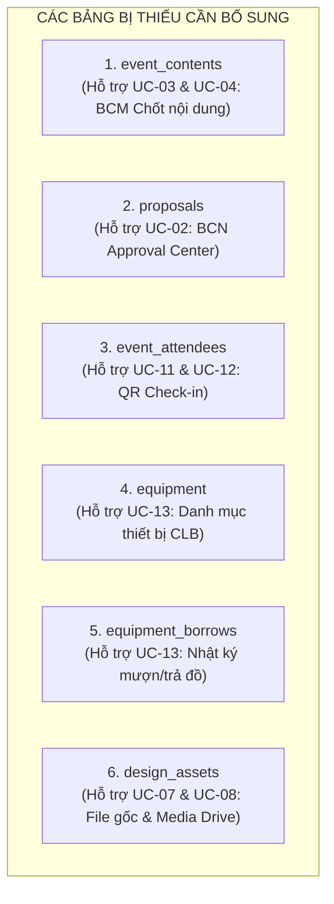

# BÁO CÁO AUDIT DATABASE SCHEMA & BỔ SUNG CÁC BẢNG CÒN THIẾU
*(Đối soát trực tiếp giữa các file migration V1-V8 và tài liệu đặc tả USE_CASES_HE_THONG_CLB_NEU.md)*

---

## I. TỔNG QUAN ĐÁNH GIÁ DATABASE HIỆN TẠI (V1 - V8)

Bộ schema hiện tại trong `backend/src/main/resources/db/migration` gồm 8 file:
* `V1__create_enums.sql`
* `V2__create_core_tables.sql`
* `V3__create_task_tables.sql`
* `V4__create_announcement_tables.sql`
* `V5__create_event_tables.sql`
* `V6__create_finance_partner_tables.sql`
* `V7__create_cms_media_activity_tables.sql`
* `V8__create_triggers.sql`

**Điểm tốt:**
- Sử dụng UUID `gen_random_uuid()` làm khóa chính chuẩn xác, an toàn bảo mật.
- Có chỉ mục (Indexes) trên các cột thường xuyên query/filter (`email`, `status`, `assigned_to`, `department`, `event_date`).
- Đã cài đặt các trigger cập nhật `updated_at` và ràng buộc kiểm tra toàn vẹn (`CHECK`).

Tuy nhiên, khi đối chiếu kỹ lưỡng với **mã nguồn Backend Java (Spring Boot)** và **17 Use Cases trong `USE_CASES_HE_THONG_CLB_NEU.md`**, hệ thống tồn tại **7 lỗi kỹ thuật/logic (Bugs)** và **thiếu 6 bảng nghiệp vụ cốt lõi**.

---

## II. CÁC BUGS & LỖI LOGIC / CẤU TRÚC ĐÃ PHÁT HIỆN TRONG V1 - V8

### 1. [BUG CRITICAL] Bảng `users` thiếu cột `google_id`
* **Vị trí:** `V2__create_core_tables.sql`
* **Mô tả:** Trong thực thể `User.java` có khai báo `@Column(unique = true) private String googleId;` và trong `AuthService.java` có gọi `userRepository.findByGoogleId(googleId)`. Tuy nhiên, trong script SQL `V2`, bảng `users` **hoàn toàn không có cột `google_id`**.
* **Hậu quả:** Khi Spring Boot khởi động với cấu hình `jpa.hibernate.ddl-auto: validate` trong `application.yml`, ứng dụng sẽ văng lỗi crash ngay lập tức: `SchemaManagementException: Missing column [google_id] in table [users]`.
* **Khắc phục:** Thêm cột `google_id VARCHAR(255) UNIQUE` kèm index vào bảng `users`.

---

### 2. [BUG LOGIC] Bảng `tasks` thiếu liên kết `event_id` tới `events`
* **Vị trí:** `V3__create_task_tables.sql`
* **Mô tả:** Trong nghiệp vụ CLB (UC-01, UC-10, UC-14), hầu hết các công việc đều phát sinh theo từng Sự kiện/Giải đấu (Tournament, Workshop, Training camp, Teambuilding). Bảng `tasks` hiện tại chỉ có `department`, `assigned_to`, `assigned_by`, hoàn toàn không có `event_id`.
* **Hậu quả:** Không thể nhóm task theo sự kiện, không thể tính % tiến độ hoàn thành của từng sự kiện trên Executive Dashboard (UC-01), và không thể thống kê tỷ lệ hoàn thành task của thành viên theo từng sự kiện (UC-10).
* **Khắc phục:** Thêm cột `event_id UUID REFERENCES events(id) ON DELETE SET NULL` kèm index vào `tasks`.

---

### 3. [BUG TỒN ĐỌNG] Enum `content_status_enum` được tạo ở V1 nhưng "bỏ quên", không có bảng nào sử dụng
* **Vị trí:** `V1__create_enums.sql`
* **Mô tả:** Trong `V1`, enum `content_status_enum` được định nghĩa với các giá trị:
  `CREATE TYPE content_status_enum AS ENUM ('idea','writing','review','approved','published');`
  Tuy nhiên từ V2 đến V8, **không có bất kỳ bảng nào sử dụng enum này**.
* **Hậu quả:** Bảng quản lý nội dung workshop/chuyên đề của Ban Chuyên Môn (UC-03 & UC-04: Content Handover & Status Lock) đã bị bỏ sót hoàn toàn.
* **Khắc phục:** Tạo bảng `event_contents` sử dụng enum này để hoàn thiện tính năng bàn giao nội dung cho BCM.

---

### 4. [BUG LOGIC TRIGGER] Trigger `update_partner_stats` chỉ bắt `AFTER INSERT`
* **Vị trí:** `V8__create_triggers.sql`
* **Mô tả:**
  ```sql
  CREATE TRIGGER trg_update_partner_stats AFTER INSERT ON collaborations 
  FOR EACH ROW EXECUTE FUNCTION update_partner_stats();
  ```
  Trigger này chỉ lắng nghe khi thêm mới hợp tác (`INSERT`). Nếu người dùng cập nhật số tiền tài trợ (`UPDATE sponsored_amount`) hoặc xóa một hợp tác (`DELETE`), bảng `partners` sẽ **không được cập nhật lại**, dẫn đến sai lệch số tiền tài trợ thực tế `total_sponsored` và số lần hợp tác `total_collaborations`.
* **Lỗi phụ:** File `V8__create_triggers.sql` bị lỗi font UTF-8 ở các dòng comment: `-- Auto update partner stats khi thAm collaboration`, `-- Ch% 1 season active`.

---

### 5. [BUG KIỂU DỮ LIỆU] `landing_content.content_json` dùng `TEXT` thay vì `JSONB`
* **Vị trí:** `V7__create_cms_media_activity_tables.sql`
* **Mô tả:** Trong `V7`, `content_json` khai báo kiểu `TEXT NOT NULL DEFAULT '{}'`. Trong khi ở bảng `activity_logs`, cột `metadata` được dùng chuẩn `JSONB`.
* **Hậu quả:** Kiểu `TEXT` không validate cú pháp JSON ở tầng database, không thể query hoặc cập nhật từng section bằng các toán tử JSON của PostgreSQL (`->`, `->>`, `@>`).
* **Khắc phục:** Chuyển đổi sang kiểu `JSONB`.

---

### 6. [BUG MỞ RỘNG] Enum `department_enum` thiếu các ban nếu CLB mở rộng cơ cấu
* **Vị trí:** `V1__create_enums.sql`
* **Mô tả:** `department_enum` hiện chỉ có: `'bcn','truyen_thong','noi_dung','su_kien','doi_ngoai'`. Nếu hệ thống cần quản lý chuyên môn sâu về Kỹ thuật (`ky_thuat`) hoặc Nhân sự (`nhan_su`), PostgreSQL sẽ từ chối lưu dữ liệu vì vi phạm enum constraint.
* **Khắc phục:** Bổ sung `ky_thuat` và `nhan_su` vào enum qua `ALTER TYPE ... ADD VALUE IF NOT EXISTS`.

---

## III. DANH SÁCH CÁC BẢNG CÒN THIẾU DỰA TRÊN USE CASES

Đối chiếu với 17 Use Case trong `USE_CASES_HE_THONG_CLB_NEU.md`, có **6 BẢNG CỐT LÕI BỊ THIẾU**:



### 1. Bảng `event_contents` (Hỗ trợ UC-03 & UC-04)
* **Nghiệp vụ:** Ban Chuyên Môn (Nội dung) quản lý kịch bản, bài giảng, đề thi, diễn giả cho từng sự kiện. Trạng thái gồm: `idea` ➔ `writing` ➔ `review` ➔ `approved` ➔ `published`.
* **Cơ chế:** Khi chuyển sang `approved` và khóa phiên bản (`is_locked = true`), hệ thống bắn thông báo cho Kỹ thuật & Truyền thông bắt đầu làm việc.
* **Các trường:** `id`, `event_id`, `title`, `speakers`, `description`, `doc_url`, `status`, `is_locked`, `approved_by`, `approved_at`, `created_by`, `created_at`, `updated_at`.

---

### 2. Bảng `proposals` (Hỗ trợ UC-02 - Approval Center)
* **Nghiệp vụ:** Trưởng các ban gửi đề xuất kế hoạch, dự trù ngân sách lên để BCN xem xét, phê duyệt (`approved`) hoặc yêu cầu sửa đổi (`rejected`) kèm lý do phản hồi `review_notes`.
* **Các trường:** `id`, `title`, `proposal_type` (kế hoạch, dự trù, đột xuất), `content`, `attachment_url` (link Docs/Drive), `event_id`, `department`, `status` (`pending`, `approved`, `rejected`), `review_notes`, `submitted_by`, `reviewed_by`, `reviewed_at`, `created_at`, `updated_at`.

---

### 3. Bảng `event_attendees` (Hỗ trợ UC-11 & UC-12 - QR Code Check-in)
* **Nghiệp vụ:** Quản lý sinh viên/khách đăng ký tham gia workshop hoặc giải đấu tranh biện. Cấp mã vé định danh duy nhất (`ticket_code`, ví dụ: `NDC-WS-001`) và mã băm QR (`qr_code_hash`).
* **Check-in:** Ghi nhận cờ `is_checked_in`, thời gian `checked_in_at`, và tài khoản lễ tân quét `checked_in_by`.
* **Các trường:** `id`, `event_id`, `ticket_code`, `qr_code_hash`, `full_name`, `email`, `phone`, `student_id`, `organization`, `is_checked_in`, `checked_in_at`, `checked_in_by`, `registered_at`, `created_at`, `updated_at`.
* **Ràng buộc:** `UNIQUE(event_id, email)` và `UNIQUE(event_id, ticket_code)`.

---

### 4 & 5. Bảng `equipment` & `equipment_borrows` (Hỗ trợ UC-13 - Quản lý CSVC & Mượn/Trả)
* **Bảng `equipment`:** Theo dõi tài sản CLB sở hữu (bộ đàm, loa kéo, standee, phướn...).
  * Các trường: `id`, `code` (Mã TB-BD-01), `name`, `category`, `total_quantity`, `available_quantity`, `condition_status` (`good`, `fair`, `damaged`, `lost`), `storage_location`, `notes`.
* **Bảng `equipment_borrows`:** Theo dõi nhật ký mượn/trả của từng thành viên.
  * Các trường: `id`, `equipment_id`, `borrower_id`, `event_id`, `quantity`, `borrowed_at`, `expected_return_at`, `actual_returned_at`, `purpose`, `status` (`borrowing`, `returned`, `overdue`, `damaged`), `return_condition_notes`, `approved_by`.

---

### 6. Bảng `design_assets` (Hỗ trợ UC-07 & UC-08 - Kho File Thiết kế Gốc & Media Drive)
* **Nghiệp vụ:** Bảng `media_links` ở V7 được thiết kế để theo dõi bài đăng mạng xã hội (Facebook, TikTok, reach, likes, shares). Nó **không phù hợp** để lưu trữ tài nguyên thiết kế gốc (Figma, AI, PSD, Brand Guidelines) hoặc link Google Drive ảnh/video sự kiện chất lượng cao (Highlights, RAW, Recap).
* **Bảng `design_assets`:**
  * Các trường: `id`, `title`, `asset_type` (`brand_identity`, `figma_source`, `design_template`, `event_photos_raw`, `event_photos_highlight`, `video_recap`), `url` (link Drive/Figma), `event_id`, `department`, `file_format`, `description`, `is_public_internal`, `created_by`.

---

### 7. Bổ sung các cột cho bảng `collaborations` (Hỗ trợ UC-05 - Hồ sơ Tài trợ & Quyền lợi)
* Bảng `collaborations` hiện tại chỉ có: `description`, `sponsored_amount`, `mou_link`, `collaboration_date`.
* Bổ sung các cột:
  - `tier VARCHAR(50)`: Gói tài trợ (Kim cương, Vàng, Bạc, Đồng, Đồng hành / Hiện vật).
  - `contract_status VARCHAR(50) DEFAULT 'da_ky'`: Trạng thái hợp đồng (`dang_dam_phan`, `da_ky`, `da_thanh_ly`).
  - `benefits_committed TEXT`: Quyền lợi cam kết (đặt logo backdrop, phát biểu, bàn tuyển dụng...).

---

## IV. FILE FLYWAY MIGRATION HOÀN CHỈNH ĐÃ TẠO

Toàn bộ các bản vá lỗi và các bảng bổ sung đã được đóng gói thành file migration chuẩn:
👉 **`F:\Coder\NEU-Debate-Club\backend\src\main\resources\db\migration\V9__supplement_missing_tables_and_fixes.sql`**

### Tóm tắt nội dung file `V9`:
1. `ALTER TABLE users ADD COLUMN IF NOT EXISTS google_id VARCHAR(255) UNIQUE;` + Index.
2. `ALTER TYPE department_enum ADD VALUE IF NOT EXISTS 'ky_thuat';` & `'nhan_su';`
3. `ALTER TABLE tasks ADD COLUMN IF NOT EXISTS event_id UUID REFERENCES events(id) ON DELETE SET NULL;` + Index.
4. `ALTER TABLE collaborations ADD COLUMN IF NOT EXISTS tier, contract_status, benefits_committed;`
5. `ALTER TABLE landing_content ALTER COLUMN content_json TYPE JSONB;`
6. `CREATE TABLE IF NOT EXISTS event_contents ...` + Indexes.
7. `CREATE TABLE IF NOT EXISTS proposals ...` + Indexes.
8. `CREATE TABLE IF NOT EXISTS event_attendees ...` + Unique Constraints & Indexes.
9. `CREATE TABLE IF NOT EXISTS equipment ...` & `CREATE TABLE IF NOT EXISTS equipment_borrows ...`
10. `CREATE TABLE IF NOT EXISTS design_assets ...` + Indexes.
11. Gắn trigger `set_updated_at()` tự động cho tất cả các bảng mới tạo.

---

## V. LƯU Ý QUAN TRỌNG VỀ CODE JAVA HIỆN TẠI

Trong quá trình audit các thực thể Java liên quan:
1. **Lỗi phân cấp quyền trong `UserPrincipal.java`:**
   ```java
   public boolean hasRole(Role requiredRole) {
       return switch (requiredRole) {
           case GUEST      -> true;
           case MEMBER     -> role == Role.MEMBER; // BUG: nếu user là TRUONG_BAN hoặc BCN sẽ bị trả về false!
           case TRUONG_BAN -> role == Role.TRUONG_BAN; // BUG: BCN bị trả về false!
           case BCN        -> role == Role.BCN;
       };
   }
   ```
   *Khắc phục:* Cần sửa lại để BCN kế thừa quyền của Trưởng ban và Member:
   ```java
   public boolean hasRole(Role requiredRole) {
       return switch (requiredRole) {
           case GUEST      -> true;
           case MEMBER     -> role == Role.MEMBER || role == Role.TRUONG_BAN || role == Role.BCN;
           case TRUONG_BAN -> role == Role.TRUONG_BAN || role == Role.BCN;
           case BCN        -> role == Role.BCN;
       };
   }
   ```
2. **Flyway tự động chạy khi khởi động Backend:**
   Khi bạn chạy lại Spring Boot (`mvnw spring-boot:run`), Flyway sẽ tự động phát hiện file `V9__supplement_missing_tables_and_fixes.sql` và thực thi migration vào PostgreSQL mà không gây xung đột hay mất mát dữ liệu hiện có.
