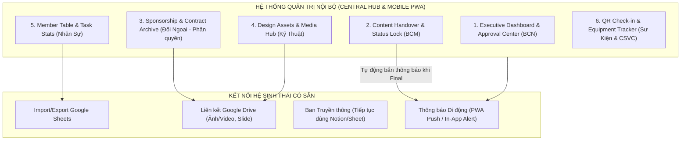

# BÁO CÁO TỔNG HỢP: NHU CẦU THỰC TẾ & GIẢI PHÁP XÂY DỰNG WEBSITE QUẢN TRỊ NỘI BỘ CLB NEU
*(Đã được chuẩn hóa và xác nhận trực tiếp qua phỏng vấn quy trình thực tế của từng Ban)*

---

## I. NGUYÊN TẮC THIẾT KẾ CỐT LÕI (TRÁNH THÊM VIỆC THỪA THÃI)

1. **Không thay thế những gì đang chạy tốt:**
   - Sinh viên đã quen thuộc với Google Sheets, Google Docs, Canva, Notion. Ban nào đã vận hành ổn định trên công cụ sẵn có (ví dụ: Ban Truyền thông đã tự lên kế hoạch trên Notion/Sheet) thì **không cố vẽ thêm tính năng trên website để bắt họ đổi thói quen**.
2. **Website là "Trạm Trung Tâm & Người Trợ Lý" (Central Hub & Companion):**
   - Chỉ can thiệp vào những điểm nghẽn thực sự gây đau đầu: **Trôi thông tin giữa các ban**, **thất lạc tài nguyên qua các thế hệ**, **mất đồ đạc thiết bị**, và **ùn tắc check-in sự kiện**.

---

## II. MA TRẬN NHU CẦU & GIẢI PHÁP THỰC TẾ THEO TỪNG BAN (ĐÃ XÁC NHẬN)

Dưới đây là bảng tổng hợp chuẩn xác 100% nhu cầu thực tế của 7 ban chuyên môn trong CLB học thuật tại NEU:

| Ban Chuyên Môn | Hiện trạng & Điểm nghẽn thực tế | Giải pháp Website Hỗ trợ (Chỉ làm cái cần) | Có cần làm module riêng? |
| :--- | :--- | :--- | :---: |
| **1. Ban Chủ Nhiệm (BCN)** | BCN quản lý chung nhưng khó nắm bắt tổng thể; các đề xuất/kế hoạch gửi qua Zalo dễ bị trôi. | • **Executive Dashboard:** Xem nhanh tiến độ các sự kiện đang chạy (% task hoàn thành, các việc trễ hạn). • **Approval Center:** Nơi tập trung tiếp nhận và xét duyệt các đề xuất/kế hoạch quan trọng từ các Trưởng ban gửi lên. | **CÓ** |
| **2. Ban Chuyên Môn (BCM)** | BCM sửa nội dung/slide trên Google Docs nhiều lần làm Kỹ thuật vẽ nhầm bản cũ, Truyền thông viết sai thông số. | • **Content Handover & Status Lock:** Quản lý vòng đời nội dung (*Drafting ➔ Reviewing ➔ FINAL APPROVED*). Khi BCM bấm chốt `FINAL APPROVED`, hệ thống tự động bắn thông báo cho Kỹ thuật và Truyền thông. | **CÓ** |
| **3. Ban Đối Ngoại (ER)** | Dữ liệu tài trợ nhạy cảm (giá trị hợp đồng, quyền lợi NTĐ, danh bạ đầu mối liên hệ qua các năm) dễ thất lạc khi đổi Gen hoặc rò rỉ nếu share Sheet công khai. | • **Sponsorship & Contract Archive:** Lưu trữ bảo mật hồ sơ hợp đồng, thông tin gói tài trợ, danh bạ liên hệ doanh nghiệp. • **Phân quyền riêng tư:** Chỉ BCN và Ban Đối ngoại có quyền truy cập. | **CÓ** |
| **4. Ban Kỹ Thuật (Design/Media)** | Thất lạc các file thiết kế gốc (AI, PSD, Figma), bộ nhận diện (Logo, font, màu chuẩn) và link Drive ảnh sự kiện chất lượng cao sau khi chuyển giao Gen. | • **Design Assets & Media Hub:** Kho lưu trữ tập trung có cấu trúc cho: Bộ nhận diện thương hiệu, file thiết kế gốc, và link Google Drive ảnh/video sự kiện chất lượng cao. | **CÓ** |
| **5. Ban Truyền Thông (PR)** | Đã tự lên kế hoạch, timeline bài viết rất quen thuộc và hiệu quả trên Notion/Google Sheets. | • **KHÔNG LÀM MODULE RIÊNG:** Không bắt Ban Truyền thông chuyển sang dùng công cụ mới. • Chỉ cần nhận thông báo tự động từ hệ thống khi BCM chốt nội dung `FINAL APPROVED` và nhận task sự kiện. | **KHÔNG** *(Tránh dư thừa)* |
| **6. Ban Nhân Sự (HR)** | Không cần quản lý hồ sơ cồng kềnh; muốn đánh giá thành viên thực dụng mà không phải chấm công/điểm danh thủ công. | • **Member Table:** Bảng danh sách thành viên gọn nhẹ (Tên, MSSV, SĐT, Ban, Gen). • **Task-based Contribution Stats:** Tự động thống kê số lượng task được giao vs task hoàn thành của từng thành viên trong mỗi sự kiện để làm cơ sở khen thưởng (tự động 100%, HR không phải nhập liệu thêm). | **CÓ** *(Gọn nhẹ)* |
| **7. Ban Sự Kiện / CSVC (Logistics)** | • Điểm danh đón tiếp sinh viên tham dự workshop bằng file Sheet gây ùn tắc. • Đồ đạc của CLB (bộ đàm, standee, loa kéo...) thường xuyên bị thất lạc, không rõ ai đang giữ. | • **Student ID / QR Check-in:** Quét mã QR/ID đón tiếp người tham gia trong 1 giây bằng điện thoại/web tại bàn check-in. • **Equipment & Asset Tracker:** Danh mục theo dõi tài sản của CLB và trạng thái mượn/trả (Ai mượn, ngày mượn, tình trạng thiết bị). | **CÓ** |

---

## III. BẢN ĐỒ KIẾN TRÚC HỆ THỐNG (SYSTEM ARCHITECTURE)

---

## IV. PHÂN QUYỀN TRUY CẬP (RBAC - ROLE-BASED ACCESS CONTROL)

1. **Ban Chủ Nhiệm (BCN):**
   - Toàn quyền hệ thống (Admin): Xem Dashboard tổng thể, duyệt đề xuất, xem/sửa tất cả các module bao gồm cả Hợp đồng tài trợ và Danh mục thiết bị.
2. **Trưởng Ban / Phó Ban:**
   - **Trưởng BCM:** Tạo và đổi trạng thái nội dung (`Draft` ➔ `Reviewing` ➔ `FINAL APPROVED`).
   - **Trưởng Ban Đối Ngoại:** Xem và quản lý Hợp đồng & Doanh nghiệp tài trợ.
   - **Trưởng Ban Kỹ Thuật:** Quản lý kho File thiết kế gốc và Link Media.
   - **Trưởng Ban Sự Kiện:** Quản trị Check-in sự kiện và Danh mục thiết bị mượn/trả.
   - **Trưởng Ban Nhân Sự:** Xem bảng danh sách thành viên và bảng thống kê tỷ lệ hoàn thành task của các thành viên.
3. **Thành viên CLB:**
   - Xem bảng thông tin chung, cập nhật trạng thái các task được giao cho bản thân, truy cập kho tài nguyên dùng chung. Không xem được dữ liệu Hợp đồng đối ngoại.

---

## V. TỔNG KẾT: TẠI SAO GIẢI PHÁP NÀY KHẢ THI VÀ ĐI VÀO ÁP DỤNG ĐƯỢC NGAY?

1. **Thực dụng tối đa:** Đã thẳng tay loại bỏ các tính năng không cần thiết (không làm tool riêng cho Truyền thông vì họ đã có Notion; không làm chấm công rườm rà cho HR mà dùng thống kê task tự động).
2. **Đúng điểm đau nhức nhối nhất:**
   - Giải quyết tận gốc bài toán BCM sửa nội dung làm Kỹ thuật/Truyền thông dùng lầm bản cũ.
   - Giải quyết bài toán thất lạc đồ đạc thiết bị của CLB sau sự kiện.
   - Giải quyết bài toán thất lạc hợp đồng tài trợ và file thiết kế gốc khi chuyển giao Gen.
   - Giải quyết bài toán ùn tắc check-in khi sinh viên đến tham gia workshop.
3. **Trải nghiệm tiện lợi:** Hỗ trợ chuẩn PWA cài thẳng lên điện thoại để ban lễ tân quét mã check-in và ban điều hành duyệt đề xuất mọi lúc mọi nơi.
