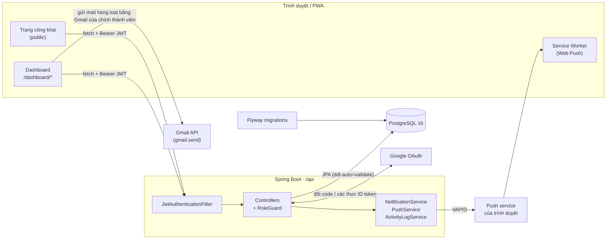
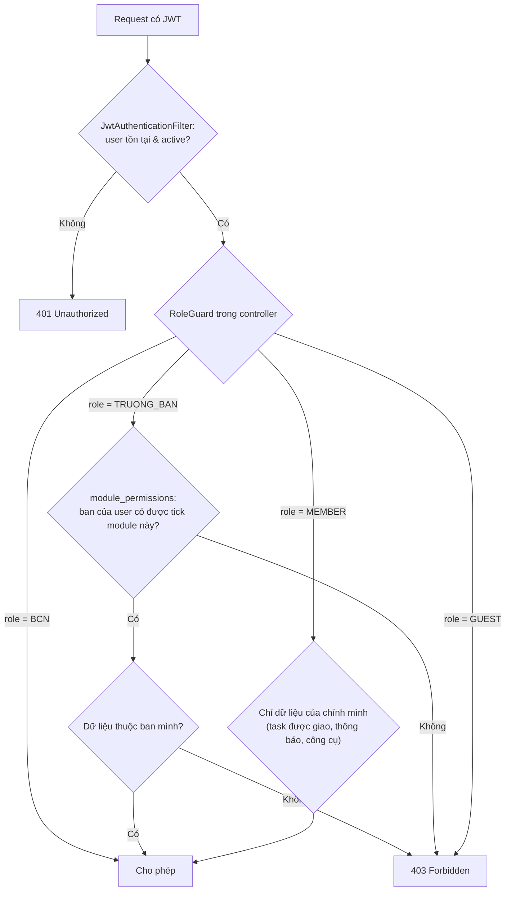
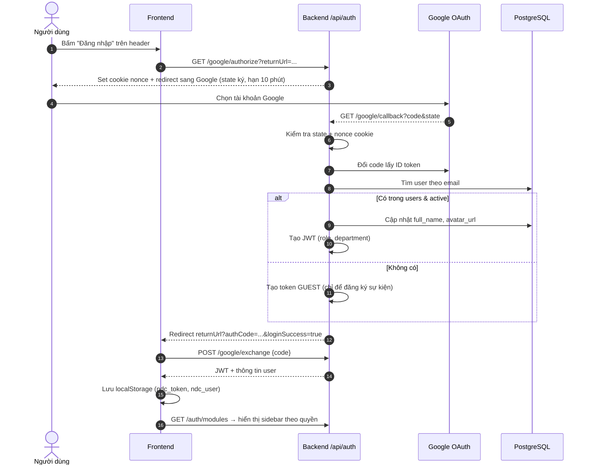
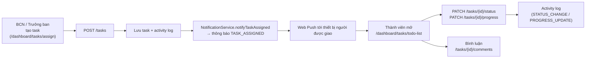
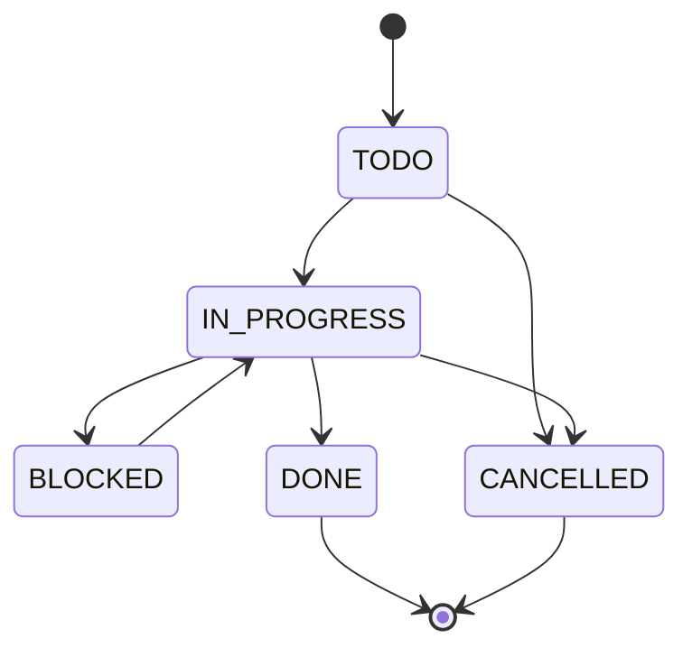
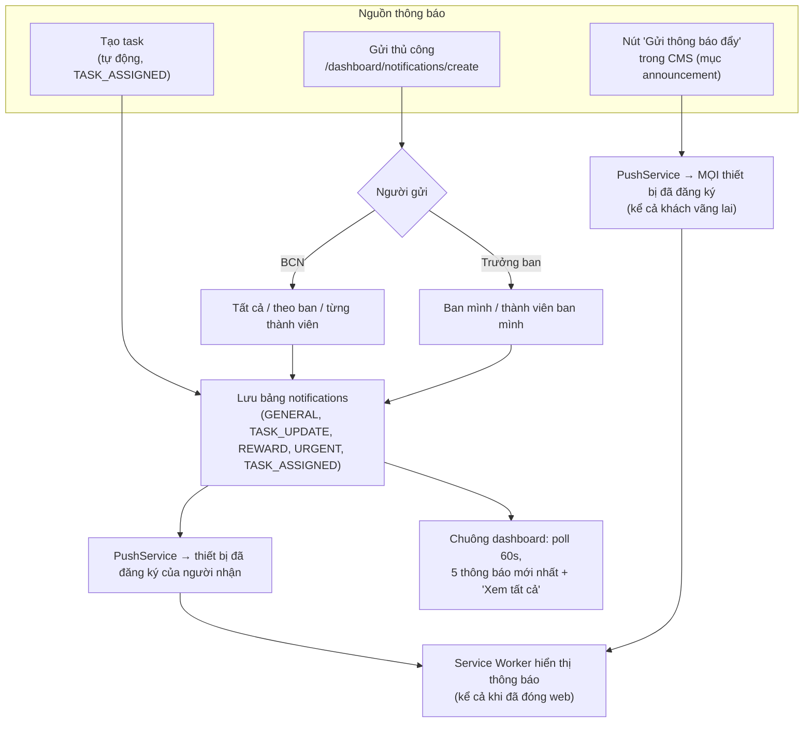
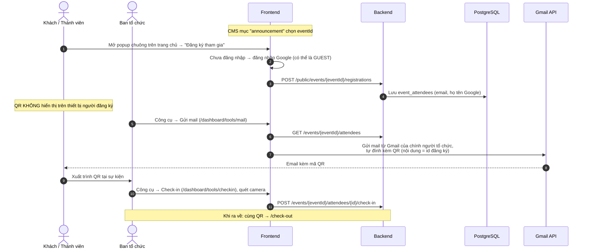
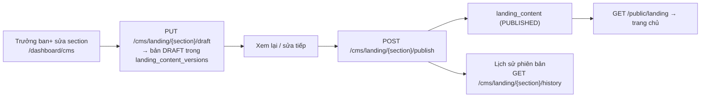
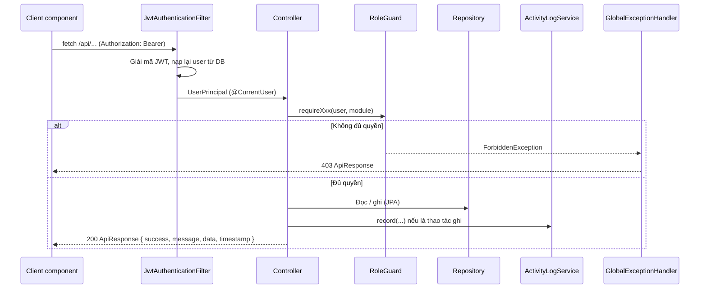
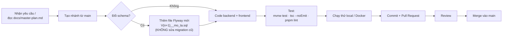

# NEU Debate Club — Website & Hệ thống quản trị CLB

Website giới thiệu công khai và dashboard quản trị nội bộ cho CLB Tranh biện NEU: quản lý thành viên, giao việc, sự kiện (đăng ký + check-in QR), tài chính, thông báo đẩy, CMS cho trang chủ và các công cụ cho thành viên.

| Thành phần | Công nghệ |
|---|---|
| Frontend | Next.js 16 (App Router), React, TypeScript 5, Tailwind 4, MUI 7, Radix UI, TanStack Query |
| Backend | Java 21, Spring Boot 4.1 (Web, Security, Data JPA, Validation, Actuator), Flyway, springdoc OpenAPI, JWT (jjwt), Google API Client, Web Push (VAPID) |
| Database | PostgreSQL 16, schema quản lý bằng Flyway (`V1`–`V26`) |
| Triển khai | Docker Compose (`db`, `backend`, `frontend`) |

---

## 1. Kiến trúc tổng quan



- **Không có SSR gọi API**: mọi lời gọi dữ liệu là `fetch` phía client tới `NEXT_PUBLIC_API_BASE_URL`.
- **Phân quyền nằm trong controller** qua `RoleGuard` (không dùng annotation method-security). Middleware Next.js chỉ chặn ở phía client.
- **Mọi thao tác ghi** (task, tài chính, sự kiện, …) được ghi lại vào `activity_logs` qua `ActivityLogService`.

---

## 2. Cấu trúc thư mục

```text
NEU-Debate-Club/
├── backend/                     # Spring Boot (Maven, mvnw)
│   ├── src/main/java/com/neudebateclub/backend/
│   │   ├── auth/                # Đăng nhập Google, JWT
│   │   ├── user/                # Thành viên (MemberController)
│   │   ├── task/                # Giao việc, tiến độ, bình luận
│   │   ├── event/               # Sự kiện, đăng ký, check-in/out QR
│   │   ├── finance/             # Thu chi (kể cả thu chi theo sự kiện)
│   │   ├── notification/        # Thông báo + Web Push
│   │   ├── permission/          # Ma trận ban → module (module_permissions)
│   │   ├── publication/         # Ấn phẩm / link tài liệu
│   │   ├── tenure/              # Nhiệm kỳ (seasons)
│   │   ├── activity/            # Nhật ký hoạt động
│   │   ├── cms/                 # Nội dung landing (draft → publish), dự án, thành tích
│   │   ├── common/              # enums, converters, ApiResponse, exceptions, RoleGuard
│   │   └── config/              # SecurityConfig, ...
│   ├── src/main/resources/db/migration/   # Flyway V1..V26
│   ├── dev-seed/                # Dữ liệu mẫu CHỈ dùng cho dev
│   └── Dockerfile
├── frontend/                    # Next.js
│   ├── src/app/(public)/        # Trang chủ, dự án, thành tích, các ban
│   ├── src/app/(dashboard)/dashboard/   # Các trang quản trị
│   ├── src/app/login, logout/
│   ├── src/components/dashboard/        # Màn hình dashboard
│   └── Dockerfile
├── docs/                        # Kiến trúc, master plan, tài liệu từng module
├── docker-compose.yml
├── DOCKER.md                    # Hướng dẫn chạy bằng Docker chi tiết
└── *.md                         # Tài liệu nghiệp vụ (nhu cầu, use case, roadmap)
```

---

## 3. Vai trò & phân quyền

| Vai trò | Mô tả |
|---|---|
| `BCN` | Ban chủ nhiệm — toàn quyền, cấu hình phân quyền module |
| `TRUONG_BAN` | Trưởng ban — dùng các module được BCN tick cho ban của mình, chỉ thao tác trong ban mình |
| `MEMBER` | Thành viên — xem task của mình, nhận thông báo, dùng nhóm **Công cụ** |
| `GUEST` | Tài khoản Google chưa có trong `users` — chỉ được đăng ký tham gia sự kiện, không vào được dashboard |

Các ban: `BCN`, `TRUYEN_THONG`, `DOI_NGOAI`, `NOI_DUNG`, `SU_KIEN`, `KY_THUAT`, `NHAN_SU`.

14 module (`AdminModule`): `TASK_ASSIGNMENT`, `NOTIFICATION_MANAGEMENT`, `DEPARTMENT_OPERATIONS`, `ANALYTICS`, `PUBLICATIONS`, `ASSET_LIBRARY`, `LANDING_CMS`, `FINANCE`, `EVENT_MANAGEMENT`, `MEMBERSHIP`, `TENURE`, `CROSS_DEPARTMENT_TASKS`, `ACTIVITY_LOG`, `HEALTH_DASHBOARD`.



> Bảng `module_permissions` ban đầu **rỗng**; BCN tick quyền tại `/dashboard/roles`. Tick chỉ cấp quyền cho **trưởng ban** của ban đó, không cấp cho `MEMBER`.

---

## 4. Các quy trình nghiệp vụ chính

### 4.1. Đăng nhập Google

JWT không bao giờ xuất hiện trên URL: backend trả về một mã dùng một lần (sống 60 giây), trình duyệt đổi mã đó lấy JWT.



### 4.2. Giao việc & theo dõi tiến độ

Quy tắc hiển thị: thành viên chỉ thấy task được giao cho mình; trưởng ban xem/sửa/xoá task trong ban mình; BCN xem tất cả; chỉ BCN giao việc cho **tất cả các ban**.





> ⚠️ `BLOCKED`, `CANCELLED` và độ ưu tiên `URGENT` đã có trong Java nhưng **chưa có trong enum PostgreSQL** — hiện bị lưu thành `todo` / `high`. Cần migration mở rộng enum (dự kiến `V27`).

### 4.3. Thông báo & Web Push



Không có trạng thái đã đọc/chưa đọc, ghim, đính kèm hay hẹn giờ (phạm vi v1).

### 4.4. Đăng ký sự kiện & check-in QR



### 4.5. Quản lý nội dung trang chủ (CMS)



Dự án và thành tích là catalog riêng (`/cms/landing/catalog/{type}`), hiển thị công khai ở `/projects` và `/achievements`.

### 4.6. Tài chính sự kiện

Thu/chi của sự kiện là các dòng `transactions` bình thường có `event_id`. Quản lý module `EVENT_MANAGEMENT` chỉ xem/thêm/xoá giao dịch gắn sự kiện; quản lý `FINANCE` xem tất cả. `events.budget` là dự toán: cảnh báo khi chi ≥ 80%, vượt khi > 100%.

---

## 5. Vòng đời một request



---

## 6. Cài đặt & chạy

### 6.1. Chạy bằng Docker (khuyến nghị)

Yêu cầu: Docker Desktop + Docker Compose v2. Chi tiết xem [DOCKER.md](DOCKER.md).

```powershell
if (!(Test-Path .env)) { Copy-Item .env.docker.example .env }
# Điền POSTGRES_PASSWORD, JWT_SECRET, GOOGLE_CLIENT_ID, GOOGLE_CLIENT_SECRET (+ VAPID_* nếu cần push)
docker compose up -d --build --wait --wait-timeout 180
```

| Dịch vụ | URL |
|---|---|
| Website | http://localhost:3000 |
| API health | http://localhost:8080/api/actuator/health |
| Swagger UI | http://localhost:8080/api/swagger-ui/index.html |
| PostgreSQL | localhost:5432 |

### 6.2. Chạy trực tiếp (dev)

Yêu cầu: JDK 21, Node.js + pnpm, PostgreSQL 16 đang chạy.

```powershell
# Backend
Copy-Item backend/.env.example backend/.env   # sửa DATABASE_*, JWT_SECRET, GOOGLE_*
cd backend; .\mvnw.cmd spring-boot:run        # Flyway tự chạy migration khi khởi động

# Frontend (terminal khác, ở thư mục gốc)
Copy-Item frontend/.env.example frontend/.env
pnpm install --dir frontend
pnpm dev:fe                                   # http://localhost:3000
```

### 6.3. Biến môi trường chính

| Biến | Dùng cho |
|---|---|
| `DATABASE_URL`, `DATABASE_USERNAME`, `DATABASE_PASSWORD` | Kết nối PostgreSQL (chạy trực tiếp) |
| `POSTGRES_DB`, `POSTGRES_USER`, `POSTGRES_PASSWORD` | Docker Compose |
| `JWT_SECRET`, `JWT_EXPIRATION_MS` | Ký JWT (mặc định 7 ngày) |
| `GOOGLE_CLIENT_ID`, `GOOGLE_CLIENT_SECRET` | Đăng nhập Google — thêm `http://localhost:3000` vào Authorized JavaScript origins |
| `NEXT_PUBLIC_GOOGLE_CLIENT_ID` | Client ID phía trình duyệt (đăng nhập + Gmail API gửi mail) |
| `VAPID_PUBLIC_KEY`, `VAPID_PRIVATE_KEY`, `VAPID_SUBJECT` | Web Push — tạo bằng `npx web-push generate-vapid-keys`; để trống = tắt push |
| `CORS_ALLOWED_ORIGINS` | Origin frontend được phép gọi API |
| `NEXT_PUBLIC_API_BASE_URL` | URL API, **nhúng lúc build** frontend (đổi thì phải build lại) |

### 6.4. Dữ liệu mẫu (chỉ dev)

```powershell
Get-Content -Raw -Encoding UTF8 backend/dev-seed/dashboard-sample-data.sql | docker exec -i ndc_db sh -c 'psql -v ON_ERROR_STOP=1 -U "$POSTGRES_USER" -d "$POSTGRES_DB"'
```

Không bao giờ chạy lên database dùng chung / production.

---

## 7. Quy trình phát triển



Quy ước:

- **Migration**: luôn thêm file mới, không sửa file đã chạy (Flyway sẽ báo lệch checksum). Dữ liệu mẫu đặt trong `backend/dev-seed/`, không đưa vào Flyway.
- **Hợp đồng API**: OpenAPI do springdoc sinh từ Java là nguồn chuẩn (xem Swagger UI).
- **Phản hồi API**: bọc trong `ApiResponse<T>`; lỗi ném `ForbiddenException`, `ResourceNotFoundException`, `ValidationException`, `UnauthorizedException`.
- **Phân quyền**: gọi `RoleGuard` ngay đầu mỗi endpoint; không dựa vào chặn ở frontend.
- **Thao tác ghi**: ghi `ActivityLogService.record(...)`.

### Lệnh kiểm tra

| Việc | Lệnh |
|---|---|
| Unit test backend (không cần DB) | `cd backend; .\mvnw.cmd test "-Dtest=*ControllerTest,*ServiceTest,RoleGuardTest"` |
| Toàn bộ test backend | `cd backend; .\mvnw.cmd test` — ⚠️ `BackendApplicationTests` chạy Flyway lên DB đã cấu hình, chỉ dùng DB tạm |
| Type-check frontend | `frontend\node_modules\.bin\tsc --noEmit -p frontend\tsconfig.json` |
| Lint frontend | `pnpm --dir frontend lint` |
| Build frontend | `pnpm --dir frontend build` |

---

## 8. Tài liệu liên quan

- [docs/architecture.md](docs/architecture.md) — kiến trúc chi tiết, cấu hình, rủi ro đã biết
- [docs/master-plan.md](docs/master-plan.md) — kế hoạch & quyết định của chủ dự án
- [docs/modules/](docs/modules/) — tài liệu từng module (auth, tasks, events, notifications, CMS, phân quyền, migration)
- [DOCKER.md](DOCKER.md) — chạy bằng Docker, logs, khôi phục
- [USE_CASES_HE_THONG_CLB_NEU.md](USE_CASES_HE_THONG_CLB_NEU.md), [NHU_CAU_VA_GIAI_PHAP_WEBSITE_CLB_NEU.md](NHU_CAU_VA_GIAI_PHAP_WEBSITE_CLB_NEU.md) — nghiệp vụ (một số điểm đã lỗi thời so với code)
