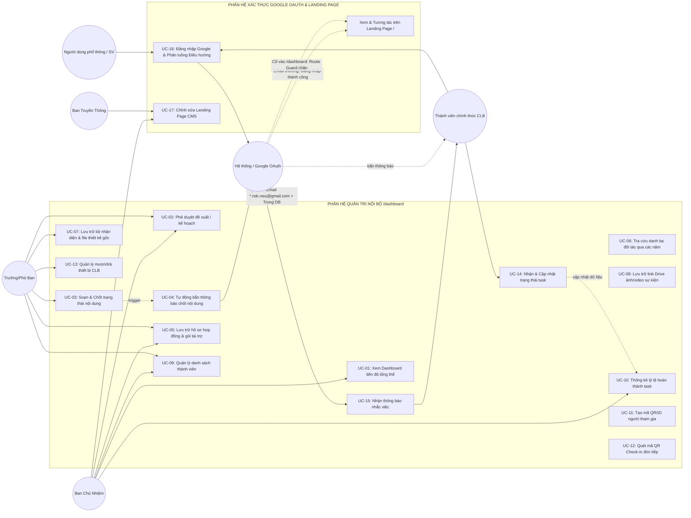

# TÀI LIỆU ĐẶC TẢ USE CASE HỆ THỐNG QUẢN TRỊ NỘI BỘ CLB NEU

_(Tài liệu đặc tả các kịch bản sử dụng dựa trên nhu cầu thực tế đã chuẩn hóa 100%)_

---

## I. DANH SÁCH CÁC TÁC NHÂN (ACTORS)

| Tác nhân (Actor)                                                    | Vai trò & Mô tả                                                                                                                                                                                                     |
| :------------------------------------------------------------------ | :------------------------------------------------------------------------------------------------------------------------------------------------------------------------------------------------------------------ |
| **Ban Chủ Nhiệm (BCN / Admin)**                                     | Người quản trị cao nhất của CLB, có quyền xem báo cáo toàn diện, phê duyệt các đề xuất/kế hoạch, chỉnh sửa Landing Page (CMS) và truy cập toàn bộ các phân hệ (kể cả Hợp đồng tài trợ).                             |
| **Trưởng / Phó Ban (Head/Sub-head)**                                | Người điều hành từng ban chuyên môn, gửi đề xuất kế hoạch cho BCN, giao việc trong ban, quản lý dữ liệu đặc thù của ban mình.                                                                                       |
| **Ban Truyền Thông (PR / Communications)**                          | Đảm nhiệm quản lý nội dung công khai trên Landing Page (CMS), tiếp nhận thông báo khi BCM chốt nội dung sự kiện để lên bài PR.                                                                                      |
| **Thành viên BCM (Member BCM)**                                     | Soạn thảo nội dung workshop/chuyên đề, cập nhật trạng thái phê duyệt nội dung.                                                                                                                                      |
| **Thành viên Đối Ngoại (Member ER)**                                | Cập nhật dữ liệu nhà tài trợ, lưu trữ hợp đồng, tra cứu danh bạ đối tác.                                                                                                                                            |
| **Thành viên Kỹ Thuật (Member Tech/Design)**                        | Đăng tải và quản lý file thiết kế gốc, link ảnh/video sự kiện chất lượng cao.                                                                                                                                       |
| **Thành viên Sự Kiện (Member Logistics)**                           | Thực hiện check-in đón tiếp sinh viên tại sự kiện, quản lý mượn/trả thiết bị CLB.                                                                                                                                   |
| **Thành viên Chính thức CLB (Official Member)**                     | Đăng nhập Google bằng email `*.ndc.neu@gmail.com` có trong database, được cấp quyền truy cập đầy đủ phân hệ nội bộ `/dashboard`.                                                                                    |
| **Người dùng Phổ thông / Sinh viên vãng lai (Public User / Guest)** | Đăng nhập Google bằng email cá nhân bất kỳ (không có đuôi thành viên); chỉ được đăng nhập và sử dụng các tính năng công khai tại Landing Page (`/`), bị chặn và điều hướng về Landing Page nếu cố vào `/dashboard`. |
| **Hệ thống (System / Google OAuth2 & Route Guard)**                 | Tác nhân tự động phân loại email, đối soát database thành viên, phân luồng điều hướng (Route Guard), tính toán thống kê và bắn thông báo.                                                                           |

---

## II. SƠ ĐỒ TỔNG QUAN USE CASE (USE CASE DIAGRAM)

---

## III. MA TRẬN PHÂN QUYỀN USE CASE (ROLE-PERMISSION MATRIX)

|   Mã Use Case   | Tên Use Case                        | Người dùng Phổ thông  | Thành viên Chính thức  |        BCN         |  Ban Truyền Thông  |     Trưởng BCM     |     Trưởng ĐN      |     Trưởng KT      |     Trưởng HR      |     Trưởng SK      |
| :-------------: | :---------------------------------- | :-------------------: | :--------------------: | :----------------: | :----------------: | :----------------: | :----------------: | :----------------: | :----------------: | :----------------: |
|    **UC-16**    | **Đăng nhập Google & Phân luồng**   | **Đăng nhập vào `/`** | **Route `/dashboard`** | Route `/dashboard` | Route `/dashboard` | Route `/dashboard` | Route `/dashboard` | Route `/dashboard` | Route `/dashboard` | Route `/dashboard` |
| **Route Guard** | **Truy cập đường dẫn `/dashboard`** | ❌ **Bị đẩy về `/`**  |    ✅ **Cho phép**     |  ✅ **Cho phép**   |  ✅ **Cho phép**   |  ✅ **Cho phép**   |  ✅ **Cho phép**   |  ✅ **Cho phép**   |  ✅ **Cho phép**   |  ✅ **Cho phép**   |
|    **UC-17**    | **Chỉnh sửa Landing Page (CMS)**    |           -           |           -            |      **CRUD**      |      **CRUD**      |         -          |         -          |         -          |         -          |         -          |
|    **UC-01**    | Xem Dashboard tiến độ tổng thể      |           -           |      R (hạn chế)       |      **CRUD**      |         R          |         R          |         R          |         R          |         R          |         R          |
|    **UC-02**    | Phê duyệt đề xuất / kế hoạch        |           -           |           -            |   **Duyệt/Sửa**    |        Gửi         |        Gửi         |        Gửi         |        Gửi         |        Gửi         |        Gửi         |
|    **UC-03**    | Soạn & Chốt trạng thái nội dung     |           -           |           R            |         R          |         R          |      **CRUD**      |         R          |         R          |         R          |         R          |
|    **UC-04**    | Bắn thông báo chốt nội dung         |           -           |        Nhận tin        |    _(Tự động)_     |      Nhận tin      |         -          |         -          |      Nhận tin      |         -          |         -          |
|    **UC-05**    | Lưu trữ hồ sơ hợp đồng tài trợ      |           -           |           -            |      **CRUD**      |         -          |         -          |      **CRUD**      |         -          |         -          |         -          |
|    **UC-06**    | Tra cứu danh bạ đối tác             |           -           |           -            |      **CRUD**      |         -          |         -          |      **CRUD**      |         -          |         -          |         -          |
|    **UC-07**    | Lưu trữ bộ nhận diện & file gốc     |           -           |           R            |         R          |         R          |         R          |         R          |      **CRUD**      |         R          |         R          |
|    **UC-08**    | Lưu trữ link Drive ảnh/video        |           -           |           R            |         R          |         R          |         R          |         R          |      **CRUD**      |         R          |         R          |
|    **UC-09**    | Quản lý danh sách thành viên        |           -           |      R (hạn chế)       |      **CRUD**      |         R          |         R          |         R          |         R          |      **CRUD**      |         R          |
|    **UC-10**    | Xem thống kê hoàn thành task        |           -           |      R (cá nhân)       |       **R**        |         R          |         R          |         R          |         R          |       **R**        |         R          |
|    **UC-11**    | Tạo mã QR/ID người tham dự          |        Nhận mã        |           -            |       **R**        |         -          |         R          |         -          |         -          |         -          |      **CRUD**      |
|    **UC-12**    | Quét mã QR Check-in sự kiện         |       Được quét       |        **Quét**        |         R          |         -          |         -          |         -          |         -          |         -          |      **Quét**      |
|    **UC-13**    | Quản lý mượn/trả thiết bị           |           -           |        Mượn/Trả        |      **CRUD**      |         -          |         -          |         -          |         -          |         -          |      **CRUD**      |
|    **UC-14**    | Cập nhật trạng thái Task            |           -           |      **Cập nhật**      |        Q.lý        |        Q.lý        |        Q.lý        |        Q.lý        |        Q.lý        |        Q.lý        |        Q.lý        |
|    **UC-15**    | Nhận thông báo nhắc việc            |           -           |         **Có**         |       **Có**       |       **Có**       |       **Có**       |       **Có**       |       **Có**       |       **Có**       |       **Có**       |

_(Ghi chú: CRUD = Tạo, Đọc, Sửa, Xóa; R = Chỉ đọc; Q.lý = Phân công và giám sát; - = Không có quyền truy cập)_

---

## IV. ĐẶC TẢ CHI TIẾT TỪNG USE CASE

### PHÂN HỆ 0: XÁC THỰC, PHÂN LUỒNG & BẢO MẬT (AUTHENTICATION & ROUTE GUARD)

#### UC-16: Đăng nhập Google Phân luồng Điều hướng (Thành viên CLB vs Người dùng Phổ thông)

- **Mô tả:** Hệ thống hỗ trợ đăng nhập Google OAuth2 cho **toàn bộ người dùng** (bao gồm cả Sinh viên/Khách vãng lai và Thành viên chính thức của CLB), sau đó áp dụng cơ chế **Phân loại Vai trò & Route Guard điều hướng**:
  1. **Nhánh 1 - Thành viên chính thức:** Đăng nhập bằng email có cú pháp `*.ndc.neu@gmail.com` **VÀ** có thông tin trong bảng `members` (trạng thái `ACTIVE`) ➔ Cấp quyền nội bộ (`ROLE_MEMBER`, `ROLE_HEAD`, `ROLE_BCN`) và tự động chuyển hướng (route) vào **`/dashboard`**.
  2. **Nhánh 2 - Người dùng phổ thông:** Đăng nhập bằng bất kỳ email Google cá nhân nào khác (như `gmail.com`, `@st.neu.edu.vn` không thuộc CLB) ➔ Đăng nhập thành công với vai trò công khai (`ROLE_PUBLIC_USER`), lưu thông tin cơ bản và điều hướng về **Landing Page (`/`)** để tham gia các tính năng công khai (đăng ký giải đấu, đăng ký tuyển Gen...).
  3. **Cơ chế Route Guard bảo vệ `/dashboard`:** Nếu Người dùng phổ thông cố tình truy cập vào `/dashboard` (nhập tay URL hoặc bấm nhầm link), hệ thống sẽ **chặn lại và điều hướng quay trở về Landing Page (`/`)** kèm thông báo nhắc nhở.
- **Tác nhân chính:** Người dùng (Thành viên CLB hoặc Sinh viên phổ thông), Hệ thống (Google OAuth2, Backend Authenticator, Frontend Route Guard).
- **Tiền điều kiện:**
  - Người dùng bấm nút "Đăng nhập Google" trên Header của Landing Page hoặc trang `/login`.
- **Luồng sự kiện chính:**
  1. Người dùng bấm **"Đăng nhập bằng Google"**.
  2. Hệ thống chuyển hướng người dùng sang màn hình xác thực tài khoản Google của Google Identity Service.
  3. Người dùng chọn tài khoản Google cá nhân hoặc tài khoản CLB để đăng nhập.
  4. Google trả về OAuth2 Token kèm thông tin người dùng (Email, Họ tên, Ảnh đại diện Google).
  5. **Backend tiến hành kiểm tra & phân luồng:**
     - **Bước 5.1 - Kiểm tra Cú pháp Email Thành viên:** Hệ thống kiểm tra xem email có khớp định dạng Regex: `^[a-zA-Z0-9._%+-]+\.ndc\.neu@gmail\.com$` hay không.
     - **Bước 5.2 - Đối soát Database Thành viên:**
       - Nếu email khớp cú pháp `.ndc.neu@gmail.com`, Backend tiếp tục truy vấn bảng `members` tìm kiếm bản ghi tương ứng có `status = 'ACTIVE'`.
  6. **Phân nhánh xử lý điều hướng (Routing Decision):**
     - **TRƯỜNG HỢP A: THÀNH VIÊN CHÍNH THỨC CLB**
       - Thỏa mãn cả 2 điều kiện (Cú pháp `*.ndc.neu@gmail.com` + Có trong bảng `members`).
       - Hệ thống cấp JWT Token chứa quyền: `ROLE_MEMBER` / `ROLE_HEAD` / `ROLE_BCN` kèm thông tin Ban chuyên môn.
       - Frontend lưu token và **chuyển hướng (Redirect) ngay lập tức vào `/dashboard`**.
       - Hiển thị giao diện Quản trị Nội bộ với đầy đủ menu các ban.
     - **TRƯỜNG HỢP B: NGƯỜI DÙNG PHỔ THÔNG (PUBLIC USER)**
       - Email không có đuôi `.ndc.neu@gmail.com` HOẶC có đuôi `.ndc.neu@gmail.com` nhưng chưa được kích hoạt trong database thành viên.
       - Hệ thống **vẫn cho phép đăng nhập thành công**, nhưng chỉ gán vai trò: `ROLE_PUBLIC_USER`.
       - Frontend lưu phiên đăng nhập công khai và **chuyển hướng (Redirect) về Landing Page (`/`)**.
       - Tại Landing Page, Navbar hiển thị Avatar và Tên người dùng (trạng thái "Đã đăng nhập"), giúp sinh viên đăng ký tham gia các giải đấu tranh biện hoặc nộp đơn tuyển thành viên nhanh chóng mà không cần nhập lại thông tin.
- **Luồng sự kiện Route Guard (Chặn truy cập trái phép vào `/dashboard`):**
  1. Khi một người dùng phổ thông (`ROLE_PUBLIC_USER`) hoặc người dùng chưa đăng nhập gõ trực tiếp URL `/dashboard` (hoặc các route con như `/dashboard/tasks`, `/dashboard/members`...) trên trình duyệt.
  2. Middleware / Component `PrivateRoute` / `AuthGuard` ở Frontend chặn yêu cầu trước khi render trang.
  3. Route Guard kiểm tra quyền trong token: Phát hiện người dùng không sở hữu quyền thành viên CLB (`ROLE_MEMBER` trở lên).
  4. Hệ thống **tự động chuyển hướng (Redirect) người dùng trở lại Landing Page (`/`)**.
  5. Hiển thị thông báo Toast thông tin: _"Khu vực Dashboard nội bộ chỉ dành riêng cho thành viên chính thức của CLB NEU Debate Club."_
- **Hậu điều kiện:**
  - Thành viên CLB vào thẳng `/dashboard` để làm việc.
  - Người dùng bên ngoài đăng nhập tiện lợi tại Landing Page, tuyệt đối không xâm nhập được vào dữ liệu nội bộ của CLB.

---

### PHÂN HỆ 0.1: QUẢN LÝ NỘI DUNG CÔNG KHAI (LANDING PAGE CMS)

#### UC-17: Chỉnh sửa Nội dung Landing Page (Landing Page CMS)

- **Mô tả:** Cho phép quản trị, cập nhật và tùy biến toàn bộ nội dung hiển thị trên trang chủ công khai (Landing Page) của CLB để quảng bá hình ảnh, tuyển thành viên mới và công bố các giải đấu/sự kiện.

- **Luồng sự kiện chính:**
  1. Người dùng vào mục quản trị: **"Quản lý Landing Page (CMS)"** (Route: `/dashboard/cms`).
  2. Hệ thống tải giao diện trực quan hiển thị danh mục các Section trên Landing Page
  3. Người dùng chọn khối Section cần chỉnh sửa, thay đổi văn bản, tải ảnh mới lên hoặc đổi đường dẫn link.
  4. Bấm nút **"Xem trước (Preview)"**: Hệ thống hiển thị bản mô phỏng giao diện Landing Page với dữ liệu vừa sửa (hỗ trợ xem trên Desktop và Mobile).
  5. Bấm nút **"Xuất bản (Publish)"**:
     - Hệ thống lưu cấu hình nội dung mới vào cơ sở dữ liệu.
     - Cập nhật tức thì (hoặc invalidate cache) lên trang Landing Page công khai `/` để sinh viên và khách bên ngoài nhìn thấy ngay.
  6. Hệ thống lưu lại nhật ký chỉnh sửa: Người cập nhật gần nhất, thời gian cập nhật.
- **Hậu điều kiện:** Landing Page công khai phản ánh chính xác thông tin truyền thông mới nhất của CLB mà không cần can thiệp vào mã nguồn (code).

---

### PHÂN HỆ 1: QUẢN TRỊ & ĐIỀU HÀNH (BAN CHỦ NHIỆM)

#### UC-01: Xem Dashboard Tiến độ Tổng thể Sự kiện

- **Mô tả:** BCN xem nhanh chỉ số hoạt động toàn CLB: danh sách sự kiện đang chạy, tỷ lệ % hoàn thành công việc của từng ban, các đầu việc trễ hạn cần đôn đốc.
- **Tác nhân chính:** Ban Chủ Nhiệm (BCN).
- **Tiền điều kiện:** BCN đã đăng nhập thành công vào hệ thống.
- **Luồng sự kiện chính:**
  1. BCN truy cập trang chủ / Executive Dashboard.
  2. Hệ thống tải và hiển thị:
     - Danh sách sự kiện đang diễn ra và mốc thời gian (timeline).
     - Biểu đồ tiến độ task của từng ban (BCM, Đối ngoại, Kỹ thuật, Truyền thông, Sự kiện).
     - Danh sách cảnh báo: các task quá hạn (Overdue) hoặc sát hạn trong 24h.
     - Tổng quan nhân sự: tổng số thành viên active.
  3. BCN chọn lọc xem theo từng sự kiện cụ thể để xem chi tiết.
- **Hậu điều kiện:** BCN nắm bắt được tình trạng vận hành để đưa ra chỉ đạo kịp thời.

---

#### UC-02: Phê duyệt Đề xuất / Kế hoạch (Approval Center)

- **Mô tả:** Nơi tiếp nhận tập trung các đề xuất, kế hoạch sự kiện, dự trù kinh phí từ các Trưởng ban gửi lên để BCN phê duyệt mà không bị trôi tin nhắn trên Zalo.
- **Tác nhân chính:** Trưởng Ban (người gửi), Ban Chủ Nhiệm (người duyệt).
- **Tiền điều kiện:** Trưởng ban đã soạn xong đề xuất/kế hoạch (kèm link Google Docs/Sheets nếu có).
- **Luồng sự kiện chính:**
  1. Trưởng ban tạo phiếu đề xuất mới: nhập Tên đề xuất, Loại (Kế hoạch sự kiện / Dự trù / Đề xuất đột xuất), Mô tả, đính kèm link Docs/Drive.
  2. Trưởng ban bấm **"Gửi duyệt BCN"**.
  3. Hệ thống tạo bản ghi ở trạng thái `Chờ duyệt` (Pending) và gửi thông báo cho BCN.
  4. BCN mở trung tâm duyệt (Approval Center), xem chi tiết nội dung và file đính kèm.
  5. BCN chọn **"Phê duyệt"** (Approved) hoặc **"Yêu cầu chỉnh sửa"** (Rejected with notes kèm lý do).
  6. Hệ thống cập nhật trạng thái và bắn thông báo phản hồi lại cho Trưởng ban gửi đề xuất.
- **Hậu điều kiện:** Kế hoạch có trạng thái pháp lý rõ ràng trong nội bộ CLB trước khi thực hiện.

---

### PHÂN HỆ 2: NỘI DUNG & BÀN GIAO (BAN CHUYÊN MÔN)

#### UC-03: Soạn thảo & Chốt Trạng thái Nội dung (Status Lock)

- **Mô tả:** Ban Chuyên Môn quản lý vòng đời nội dung của workshop/chuyên đề để tránh tình trạng các ban khác sử dụng bản nháp hoặc bản cũ.
- **Tác nhân chính:** Trưởng/Thành viên Ban Chuyên Môn (BCM).
- **Tiền điều kiện:** Sự kiện đã được tạo trong hệ thống.
- **Luồng sự kiện chính:**
  1. BCM tạo mục nội dung sự kiện: Tên chuyên đề, Diễn giả dự kiến, Đề cương/Kịch bản vắn tắt, Link Google Docs bài giảng/workshop.
  2. Ban đầu nội dung ở trạng thái: `Đang soạn thảo` (Drafting). Các ban khác có thể xem nhưng có cảnh báo "Bản chưa chốt, không dùng thiết kế/viết bài".
  3. Sau khi hoàn thiện, BCM chuyển trạng thái sang `Chờ duyệt chuyên môn` (Reviewing).
  4. Khi Trưởng BCM / Cố vấn chốt bản cuối cùng, Trưởng BCM bấm nút **"CHỐT NỘI DUNG (FINAL APPROVED)"**.
  5. Hệ thống khóa chỉnh sửa các thông số chính và kích hoạt **UC-04**.
- **Luồng ngoại lệ:** Nếu cần sửa đổi đột xuất sau khi đã chốt, BCM phải mở khóa (Unlock with Reason), hệ thống sẽ gửi cảnh báo "Nội dung đã bị thay đổi" cho Kỹ thuật và Truyền thông.

---

#### UC-04: Tự động Bắn Thông báo Chốt Nội dung

- **Mô tả:** Hệ thống tự động kích hoạt thông báo tức thì đến Ban Kỹ Thuật và Ban Truyền Thông ngay khi BCM bấm `FINAL APPROVED`.
- **Tác nhân chính:** Hệ thống (System).
- **Tiền điều kiện:** UC-03 chuyển sang trạng thái `FINAL APPROVED`.
- **Luồng sự kiện chính:**
  1. Hệ thống phát hiện sự kiện đổi trạng thái sang `FINAL APPROVED`.
  2. Hệ thống tự động tạo thông báo:
     - Gửi Ban Kỹ Thuật: _"Nội dung [Tên sự kiện] đã chốt bản cuối. Bắt đầu thiết kế Key Visual / Poster chính thức."_ kèm link docs nội dung chuẩn.
     - Gửi Ban Truyền Thông: _"Nội dung [Tên sự kiện] đã chốt bản cuối. Bắt đầu viết bài PR và lên timeline."_
  3. Đẩy thông báo qua PWA Push Notification và In-App Notification Bell.
- **Hậu điều kiện:** Ban Kỹ Thuật và Ban Truyền Thông nắm thông tin ngay lập tức, triệt tiêu nguy cơ thiết kế sai bản cũ.

---

### PHÂN HỆ 3: HỒ SƠ TÀI TRỢ & ĐỐI TÁC (BAN ĐỐI NGOẠI)

#### UC-05: Lưu trữ Hồ sơ Hợp đồng & Gói Tài trợ

- **Mô tả:** Lưu trữ tập trung và bảo mật thông tin các gói tài trợ, hợp đồng ký kết với doanh nghiệp cho từng sự kiện.
- **Tác nhân chính:** Ban Đối Ngoại, Ban Chủ Nhiệm.
- **Tiền điều kiện:** Người dùng thuộc nhóm quyền BCN hoặc Ban Đối Ngoại. Các thành viên ban khác không nhìn thấy phân hệ này.
- **Luồng sự kiện chính:**
  1. Thành viên Đối ngoại vào phân hệ "Hồ sơ Tài trợ" (Sponsorship Archive).
  2. Chọn sự kiện và bấm **"Thêm Nhà Tài Trợ"**.
  3. Nhập các trường thông tin:
     - Tên Doanh nghiệp / Tổ chức.
     - Hạng mục tài trợ (Kim cương, Vàng, Bạc, Đồng, Đồng hành / Hiện vật).
     - Giá trị tài trợ (Tiền mặt / Quy đổi hiện vật).
     - Tình trạng hợp đồng (Đang đàm phán / Đã ký kết / Đã thanh lý).
     - Link lưu trữ bản scan Hợp đồng (Google Drive bảo mật).
     - Quyền lợi cam kết chính (đặt logo, phát biểu, bàn tuyển dụng...).
  4. Bấm **"Lưu hồ sơ"**.
- **Hậu điều kiện:** Dữ liệu hợp đồng được lưu trữ vĩnh viễn, không bị mất khi chuyển giao sang Gen mới.

---

#### UC-06: Tra cứu Danh bạ Đối tác Doanh nghiệp Qua các Năm

- **Mô tả:** Tra cứu thông tin người liên hệ (Contact Point), lịch sử tài trợ của các doanh nghiệp để tái liên hệ cho các mùa sau.
- **Tác nhân chính:** Ban Đối Ngoại, Ban Chủ Nhiệm.
- **Luồng sự kiện chính:**
  1. Người dùng vào mục "Danh bạ Doanh nghiệp / Đối tác".
  2. Nhập từ khóa tìm kiếm (Tên công ty, Lĩnh vực, Người liên hệ).
  3. Hệ thống hiển thị:
     - Thông tin đầu mối: Họ tên, Chức vụ, Email, SĐT, Link LinkedIn.
     - Lịch sử tài trợ: Doanh nghiệp đã từng tài trợ cho sự kiện nào các năm trước, giá trị bao nhiêu, phản hồi thế nào.
  4. Người dùng cập nhật ghi chú mới nếu thông tin liên hệ có thay đổi.

---

### PHÂN HỆ 4: KHO TÀI NGUYÊN THIẾT KẾ & MEDIA (BAN KỸ THUẬT)

#### UC-07: Lưu trữ Bộ Nhận diện & File Thiết kế Gốc

- **Mô tả:** Lưu trữ có cấu trúc các file thiết kế gốc (Figma, AI, PSD) và Brand Guidelines của CLB để Gen sau không phải vẽ lại từ đầu.
- **Tác nhân chính:** Ban Kỹ Thuật (Design).
- **Luồng sự kiện chính:**
  1. Thành viên Kỹ thuật vào "Design Assets Hub".
  2. Xem hoặc thêm mới các mục tài nguyên:
     - Bộ nhận diện: Logo chính thức (PNG, SVG), Mã màu chuẩn (HEX/RGB), Font chữ quy chuẩn.
     - Key Visual gốc theo sự kiện (kèm Link file nguồn Figma / Drive file PSD/AI).
     - Mẫu Template ấn phẩm (Story template, Quote template, Slide template).
  3. Lưu đường link và ghi chú mô tả cách sử dụng.
- **Hậu điều kiện:** Thành viên toàn CLB có thể tra cứu và tải logo chuẩn để dùng, tránh dùng logo méo/sai màu.

---

#### UC-08: Lưu trữ Link Drive Ảnh & Video Sự kiện Chất lượng Cao

- **Mô tả:** Gom và phân loại các thư mục Google Drive chứa ảnh gốc/ảnh đã chỉnh sửa và video sau mỗi sự kiện.
- **Tác nhân chính:** Ban Kỹ Thuật (Media), Ban Chủ Nhiệm.
- **Luồng sự kiện chính:**
  1. Sau sự kiện, thành viên Media tải ảnh/video lên Google Drive của CLB.
  2. Vào mục "Media Hub", chọn sự kiện tương ứng.
  3. Dán Link Drive: Thư mục ảnh sự kiện (Highlights), Thư mục ảnh gốc (RAW), Link Video Recap.
  4. Chọn trạng thái: `Đang làm hậu kỳ` hoặc `Đã hoàn thiện (Public nội bộ)`.
  5. Hệ thống hiển thị link tập trung trong Hồ sơ sự kiện để Ban Truyền thông và BCN lấy ảnh làm recap/báo cáo nhà tài trợ.

---

### PHÂN HỆ 5: QUẢN LÝ THÀNH VIÊN & HIỆU SUẤT (BAN NHÂN SỰ)

#### UC-09: Quản lý Danh sách Thành viên (Member Table)

- **Mô tả:** Quản lý bảng dữ liệu danh sách thành viên gọn nhẹ, phục vụ tra cứu thông tin nội bộ và cấp quyền tài khoản Google `*.ndc.neu@gmail.com`.
- **Tác nhân chính:** Ban Nhân Sự (HR), Ban Chủ Nhiệm.
- **Luồng sự kiện chính:**
  1. Ban Nhân sự truy cập "Danh sách Thành viên".
  2. Bảng hiển thị các cột: Họ tên, Email chính thức (`*.ndc.neu@gmail.com`), MSSV, Khóa/Lớp, Ban chuyên môn, Thế hệ (Gen), Số điện thoại, Chức vụ (BCN, Trưởng ban, Thành viên), Trạng thái (`ACTIVE` / `INACTIVE`).
  3. Hỗ trợ tính năng:
     - Thêm nhanh thành viên mới hoặc Import từ file Excel/Google Sheet.
     - Tìm kiếm theo tên hoặc lọc theo Ban/Gen.
     - Đổi trạng thái kích hoạt tài khoản (`ACTIVE`) để cho phép hoặc chặn thành viên đăng nhập vào hệ thống.
     - Xuất dữ liệu ra Excel khi cần nộp danh sách cho Đoàn/Hội trường NEU.

---

#### UC-10: Thống kê Tự động Tỷ lệ Hoàn thành Task theo Thành viên

- **Mô tả:** Hệ thống tự động đếm số lượng task được giao và task hoàn thành của từng thành viên sau mỗi sự kiện để làm cơ sở đánh giá tích cực/khen thưởng cuối kỳ mà HR không phải nhập liệu thêm.
- **Tác nhân chính:** Hệ thống (tính toán tự động), Ban Nhân Sự & BCN (xem báo cáo).
- **Luồng sự kiện chính:**
  1. Khi các task trong sự kiện được thành viên cập nhật sang `Done`, hệ thống tự động ghi nhận điểm tích lũy vào hồ sơ thành viên.
  2. HR hoặc BCN mở trang "Báo cáo Đóng góp Thành viên".
  3. Hệ thống hiển thị bảng thống kê:
     - Tổng task được giao.
     - Số task hoàn thành đúng hạn (On-time).
     - Số task trễ hạn (Late).
     - Tỷ lệ % hoàn thành công việc.
  4. Hệ thống xếp hạng top thành viên đóng góp tích cực nhất trong dự án/kỳ hoạt động.

---

### PHÂN HỆ 6: QUẢN LÝ SỰ KIỆN & CƠ SỞ VẬT CHẤT (BAN SỰ KIỆN / CSVC)

#### UC-11: Tạo Mã QR / ID cho Người Tham gia Sự kiện

- **Mô tả:** Cấp mã ID định danh và mã QR cho sinh viên đã đăng ký tham gia workshop/sự kiện để phục vụ check-in nhanh tại bàn đón tiếp.
- **Tác nhân chính:** Ban Sự Kiện (Logistics), Sinh viên đăng ký.
- **Luồng sự kiện chính:**
  1. Ban Sự Kiện import danh sách sinh viên đăng ký từ Google Form (Họ tên, MSSV, Email, SĐT).
  2. Hệ thống tự động sinh Mã vé định danh duy nhất (VD: `WS-AI-001`) và mã QR tương ứng cho từng người.
  3. Sinh viên có thể nhận mã qua Email hoặc chụp màn hình mã QR xác nhận.

---

#### UC-12: Quét Mã QR Check-in Đón tiếp Sinh viên

- **Mô tả:** Ban Lễ tân/Sự kiện dùng điện thoại hoặc webcam máy tính tại bàn đón tiếp để quét mã QR check-in trong 1 giây, hiển thị sĩ số thực tế realtime.
- **Tác nhân chính:** Thành viên Ban Sự Kiện / Ban Lễ tân.
- **Tiền điều kiện:** Thành viên mở màn hình Quét Check-in trên Web/PWA App.
- **Luồng sự kiện chính:**
  1. Người tham dự đưa mã QR trên điện thoại ra trước camera.
  2. Hệ thống quét và nhận diện mã trong 1 giây:
     - Nếu hợp lệ và chưa check-in: Hệ thống phát tiếng _beep_, hiển thị Họ tên, Lớp/MSSV, đổi trạng thái sang `Đã tham gia` kèm thời gian check-in.
     - Nếu đã check-in trước đó: Cảnh báo _"Mã này đã check-in lúc hh:mm"_.
     - Nếu mã không tồn tại: Cảnh báo _"Mã không hợp lệ"_.
  3. Bộ đếm realtime trên màn hình tự động nhảy số: `Đã check-in: 145 / 200 (72.5%)`.
- **Hậu điều kiện:** Không còn cảnh sinh viên đứng xếp hàng chờ dò tên thủ công trên file Excel.

---

#### UC-13: Quản lý Danh mục Thiết bị & Mượn/Trả CSVC CLB

- **Mô tả:** Theo dõi danh sách tài sản thuộc sở hữu CLB (bộ đàm, loa kéo, standee, phướn, dây cắm...) và nhật ký ai đang mượn để tránh thất lạc đồ đạc sau mỗi sự kiện.
- **Tác nhân chính:** Ban Sự Kiện / Cơ sở vật chất, Thành viên mượn đồ.
- **Luồng sự kiện chính:**
  1. Ban Sự Kiện xem danh mục thiết bị của CLB (Tên món, Mã thiết bị, Số lượng, Tình trạng sử dụng tốt/hỏng).
  2. Khi có sự kiện hoặc thành viên mượn đồ:
     - Chọn thiết bị ➔ Bấm **"Tạo lượt mượn"**.
     - Chọn Người mượn (tên thành viên trong CLB), Ngày mượn, Ngày hẹn trả, Mục đích (chạy sự kiện X).
     - Thiết bị chuyển trạng thái sang `Đang cho mượn`.
  3. Khi trả đồ:
     - Bấm **"Xác nhận trả đồ"** ➔ Ghi nhận tình trạng (Bình thường / Hư hỏng nếu có).
     - Thiết bị quay về trạng thái `Sẵn sàng trong kho`.
  4. Cảnh báo quá hạn: Nếu quá ngày hẹn trả mà chưa trả, hệ thống gửi thông báo nhắc nhở thành viên đang giữ đồ.

---

### PHÂN HỆ 7: CÔNG VIỆC & THÔNG BÁO CHUNG

#### UC-14: Nhận và Cập nhật Trạng thái Task Cá nhân

- **Mô tả:** Thành viên xem danh sách các task được giao trong sự kiện và cập nhật tiến độ làm việc (_Cần làm ➔ Đang làm ➔ Đã hoàn thành_).
- **Tác nhân chính:** Thành viên CLB.
- **Luồng sự kiện chính:**
  1. Thành viên đăng nhập và vào mục "Công việc của tôi" (My Tasks).
  2. Xem các task được phân công theo deadline và mức độ ưu tiên.
  3. Kéo thả hoặc bấm đổi trạng thái: `To Do` ➔ `In Progress` ➔ `Done`.
  4. Nếu công việc có sản phẩm (file docs, link bài viết), thành viên dán link đính kèm.
- **Hậu điều kiện:** Bảng tiến độ chung tự động cập nhật và gửi dữ liệu cho UC-01 và UC-10.

---

#### UC-15: Nhận Thông báo Đẩy (PWA Push / In-App Alert)

- **Mô tả:** Hệ thống chủ động gửi thông báo đến điện thoại thành viên khi có sự kiện quan trọng.
- **Tác nhân chính:** Hệ thống (System), Người dùng nhận tin.
- **Các kịch bản nhận thông báo:**
  - Được giao một task mới kèm deadline.
  - Nhắc nhở trước 24h và 2h khi task sắp đến hạn.
  - Ban Kỹ thuật & Truyền thông nhận báo động khi BCM chốt `FINAL APPROVED`.
  - BCN nhận thông báo khi có đề xuất/kế hoạch mới cần duyệt.
  - Thành viên mượn đồ nhận thông báo khi quá hạn trả thiết bị.

---

## V. TỔNG KẾT & TÍNH KHẢ THI TRIỂN KHAI

Tài liệu Use Case trên đáp ứng đúng 3 tiêu chí cốt lõi:

1. **Phân luồng thông minh, thân thiện với người dùng:** Mọi người đều có thể đăng nhập Google. Người ngoài đăng nhập tiện lợi tại Landing Page để tương tác/đăng ký sự kiện, còn thành viên chính thức được tự động đưa vào `/dashboard`.
2. **Bảo mật tuyệt đối phân hệ nội bộ bằng Route Guard:** Bất kỳ truy cập trái phép nào vào `/dashboard` từ tài khoản không thuộc danh sách thành viên đều bị chặn đứng và đưa về lại Landing Page.
3. **Trao quyền truyền thông (CMS) cho BCN và Ban Truyền Thông:** Dễ dàng biên tập nội dung công khai trên trang chủ để phục vụ công tác đối ngoại và tuyển sinh/giải đấu.
