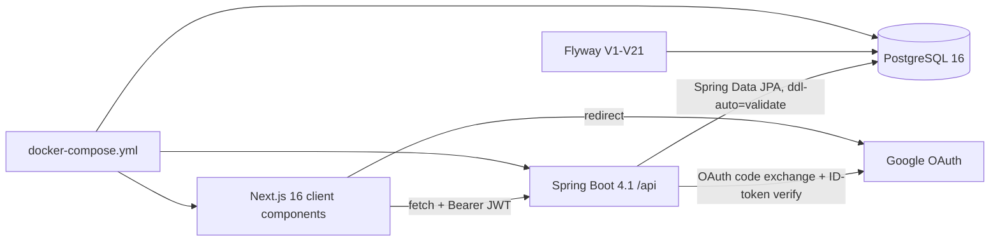

# Repository architecture

**Audit date:** 2026-11-13, against commit `f3033a5` on `main` (clean working tree).
**Previous audit:** 2026-10-18. Facts from that audit were re-checked; stale statements were corrected rather than kept.

## Evidence legend

- **Verified** — read directly in source, configuration, migrations, or git history, or produced by a command run during this audit (command and result recorded below).
- **Inferred** — follows from verified code paths but was not exercised against a running system.
- **Unknown** — needs a live database, deployment, or product-owner decision.

## System overview (verified)

| Layer | Implementation | Manifest / entry point |
|---|---|---|
| Frontend | Next.js `^16.2.2`, React Compiler, TypeScript 5, App Router, Tailwind 4, MUI 7, Radix, TanStack Query provider. All data fetching is client-side `fetch` in `"use client"` components. | [frontend/package.json](../frontend/package.json), [next.config.ts](../frontend/next.config.ts) (`output: "standalone"`) |
| Backend | Java 21, Spring Boot 4.1.0 (web, security, data-jpa, validation, actuator, flyway), springdoc 3.1.1, jjwt 0.12.3, google-api-client 2.2.0, Lombok | [backend/pom.xml](../backend/pom.xml), [BackendApplication.java](../backend/src/main/java/com/neudebateclub/backend/BackendApplication.java) |
| Database | PostgreSQL 16 (Compose image `postgres:16-alpine`); schema owned by Flyway SQL migrations V1–V21 | [db/migration/](../backend/src/main/resources/db/migration/) |
| Orchestration | Compose services `db`, `backend`, `frontend`; named volume `ndc_postgres_data` | [docker-compose.yml](../docker-compose.yml), [DOCKER.md](../DOCKER.md) |

### Repository boundaries (verified)

- Root [package.json](../package.json) is a pnpm workspace root whose only script is `dev:fe`. [pnpm-workspace.yaml](../pnpm-workspace.yaml) lists only `frontend`.
- [frontend/](../frontend/) carries its **own** `pnpm-workspace.yaml` and `pnpm-lock.yaml`; a second `pnpm-lock.yaml` exists at the root. The frontend Docker build uses the frontend lockfile.
- [backend/](../backend/) is a standalone Maven project (wrapper `mvnw`/`mvnw.cmd`) and is not part of the pnpm workspace.
- No CI configuration (`.github/` or similar) exists.
- Root-level product documents (Vietnamese): [NHU_CAU_VA_GIAI_PHAP_WEBSITE_CLB_NEU.md](../NHU_CAU_VA_GIAI_PHAP_WEBSITE_CLB_NEU.md), [USE_CASES_HE_THONG_CLB_NEU.md](../USE_CASES_HE_THONG_CLB_NEU.md), [IMPLEMENTATION_ROADMAP.md](../IMPLEMENTATION_ROADMAP.md), [DB_SCHEMA_AUDIT_VA_BO_SUNG.md](../DB_SCHEMA_AUDIT_VA_BO_SUNG.md). These describe intended behaviour; they are not executable contracts and several statements in them no longer match code (see [master-plan.md](master-plan.md) risk R-13).
- Tracked files with no referenced purpose: `test.json` (a hero-section JSON sample), `test.txt` (empty), `skills-lock.json` (agent tooling). `frontend/src/.env.local` is tracked but empty.

## Backend structure (verified)

Package-by-feature under `com.neudebateclub.backend`. There is **no service layer** except `AuthService`: controllers call repositories directly, and request/response DTOs are Java records nested inside each controller.

| Package | Entities | Repositories | Controller | Tables |
|---|---|---|---|---|
| `auth` | — (uses `User`) | — | `AuthController` + `AuthService`, `JwtService`, `JwtAuthenticationFilter` | `users` |
| `user` | `User` | `UserRepository` | `MemberController` | `users` |
| `task` | `Task`, `TaskComment` | `TaskRepository`, `TaskCommentRepository` | `TaskController` | `tasks`, `task_comments` |
| `event` | `Event` | `EventRepository` | `EventController` | `events` |
| `cms` | `LandingContent`, `LandingContentVersion`, `LandingProject`, `LandingAchievement` | one per entity | `LandingContentController`, `LandingCatalogController` | `landing_content`, `landing_content_versions`, `projects`, `achievements` |
| `controller` | — | — | `HealthController` | — |
| `common` | enums, converters, `ApiResponse`, `PageResponse`, exceptions, `RoleGuard`, `@CurrentUser` | | | |
| `config` | `SecurityConfig`; `CacheConfig` and `SwaggerConfig` are **empty classes** | | | |

**JPA-mapped tables:** 8 of the 28 tables created by migrations (`users`, `tasks`, `task_comments`, `events`, `landing_content`, `landing_content_versions`, `projects`, `achievements`). Everything else is schema-only — see [schema-backed-unimplemented.md](modules/schema-backed-unimplemented.md).

**Cross-cutting conventions (verified, inconsistent):**

- Response envelope: `ApiResponse<T>` (`success`, `message`, `data`, `timestamp`) is used by auth, members, events, tasks and health. CMS section endpoints return raw `String`/`Map`, and public catalog endpoints return JPA entities (`LandingProject`, `LandingAchievement`) directly. The frontend copes with `payload.data ?? payload`.
- Enum casing on the wire: `/auth/me` returns lowercase `role`/`department`; members, tasks and events return uppercase Java enum names.
- Transactions: CMS controllers use Spring `@Transactional`; Member/Event/Task controllers use `jakarta.transaction.Transactional`.
- Error mapping: `GlobalExceptionHandler` maps custom exceptions to 400/401/403/404 and everything else to 500. Malformed JSON or an invalid enum query parameter (e.g. `GET /tasks?status=foo`) therefore becomes **500**, not 400 (inferred from handler set; not exercised).

## Security model (verified)

- Stateless JWT (HS256 via jjwt; claims `role`, `department`, subject = user id). [JwtAuthenticationFilter](../backend/src/main/java/com/neudebateclub/backend/auth/jwt/JwtAuthenticationFilter.java) reloads the user from `users` on every request and ignores inactive users.
- `permitAll`: `/auth/google`, `/auth/google/**`, `/auth/logout`, `/actuator/health`, all `GET /public/**`, springdoc paths. Everything else requires authentication — including `GET /health` (not in the allow-list).
- Authorization is enforced **inside controllers** via [RoleGuard](../backend/src/main/java/com/neudebateclub/backend/common/security/RoleGuard.java) (`requireMemberOrAbove`, `requireTruongBanOrAbove`, `requireBCN`, `requireModuleManager(AdminModule)`). No method-security annotations are used. See [access-control.md](modules/access-control.md).
- Frontend: [middleware.ts](../frontend/src/middleware.ts) is a no-op. [DashboardAccessGuard](../frontend/src/components/layout/DashboardAccessGuard.tsx) redirects a signed-in user lacking a module; `UserProvider` redirects anonymous visitors away from `/dashboard` after its session check. Both are client-side only.
- Token storage: `localStorage` keys `ndc_token`, `ndc_user`.

## Database ownership and migration behaviour

**Schema authority (verified):** Flyway migrations `V1`–`V21` in `classpath:db/migration`. Hibernate runs with `ddl-auto: validate`, so it checks mapped columns but never creates them. [CREATE_NEU_DEBATE_CLUB.sql](../backend/src/main/resources/db/CREATE_NEU_DEBATE_CLUB.sql) is a `psql` wrapper that `\ir`-includes the same 21 files; it is not an independent schema and, when used, bypasses `flyway_schema_history`.

**Migration integrity findings (verified from git history):**

| Migration | First commit | Later edit | Effect on an already-migrated database |
|---|---|---|---|
| `V1__create_enums.sql` | `923d8fa` (2026-07-29) | `4aeb762` (2026-10-09) added `landing_project_enum`, `landing_achievement_enum` | Flyway checksum mismatch on validate; DB lacks both types, so V14/V15 would fail. |
| `V2__create_core_tables.sql` | `923d8fa` | `c2d8c34` (2026-08-04) removed `google_id VARCHAR(255) NOT NULL UNIQUE` | Checksum mismatch; DB keeps `google_id NOT NULL`, so creating members without a Google id (`POST /members`, V18 seed) would fail. |
| `V12__repair_landing_content.sql` | `4aeb762` | `e0d851c` (2026-10-18) changed the seeded BCN account e-mail and the `ON CONFLICT` target | Checksum mismatch for DBs that ran the original. |

Combined with `baseline-on-migrate: true` / `baseline-version: 12` in [application.yml](../backend/src/main/resources/application.yml), a non-empty database without Flyway history is stamped as V12 and only V13+ run. Whether any real database is in one of these states is **unknown**. Details and safe-handling notes: [database-migrations.md](modules/database-migrations.md).

**Sample data inside versioned migrations (verified):** V10–V12 and V16–V17 seed landing content; V12 seeds a fixed BCN account (`id 00000000-0000-0000-0000-000000000001`); V18 inserts 50 sample members (`thanhvienNN.ndc.neu@gmail.com`); V20 inserts 10 sample events. These run in every environment Flyway touches, including production.

**Java ↔ PostgreSQL enum drift (verified):**

| Java enum | PostgreSQL enum | Drift | Behaviour |
|---|---|---|---|
| `TaskStatus` {TODO, IN_PROGRESS, BLOCKED, DONE, CANCELLED} | `task_status_enum` {todo, in_progress, done} | `BLOCKED`, `CANCELLED` | [TaskStatusConverter](../backend/src/main/java/com/neudebateclub/backend/common/converter/TaskStatusConverter.java) silently writes them as `todo`. |
| `TaskPriority` {LOW, MEDIUM, HIGH, URGENT} | `task_priority_enum` {low, medium, high} | `URGENT` | Converter silently writes `high`. |
| `Department`, `Role`, `EventStatus`, `LandingSection` | matching enums (department extended in V9) | none | — |

The API accepts the extra values, so a client can send `BLOCKED` and get back `TODO`.

## Configuration (verified)

| Setting | Direct run (`backend/.env.example`) | `application.yml` default | `application-local.yml` default | Compose |
|---|---|---|---|---|
| Profile | `local` | `spring.profiles.default: local` | — | `SPRING_PROFILES_ACTIVE` default `default` |
| DB name | `neudebateclub` | `neu_debate_club` | `clubhub` | `${POSTGRES_DB:-neu_debate_club}` |

- Three different default database names exist. With the `local` profile and no `DATABASE_URL`, the backend targets `clubhub`.
- `application.yml` imports `optional:file:.env[.properties]` relative to the working directory, so `mvnw` from `backend/` picks up `backend/.env` if present.
- `ALLOWED_DOMAIN` appears in both env templates but **no Java code reads it**; Compose does not pass it. The membership suffix rule described in the use-case document is not enforced (and [AuthServiceTest](../backend/src/test/java/com/neudebateclub/backend/auth/AuthServiceTest.java) asserts it is not required).
- `NEXT_PUBLIC_API_BASE_URL` (default `http://localhost:8080/api`) is baked into the frontend at build time.
- CMS images live in MinIO (bucket `media`), uploaded via `POST /api/cms/images` and served at `/media/*` (Caddy in prod, a `next.config.ts` rewrite in dev).
- `frontend/package.json` does **not** declare `react` or `react-dom`; they are resolved through pnpm peer auto-install. ESLint warns that `react` is not installed for its version detection.
- `pom.xml` includes `com.h2database:h2` (runtime) though no profile uses H2.

## Build and test commands

Run from the repository root unless noted. Windows PowerShell examples; the `pnpm` shim may need `pnpm.cmd`.

| Layer | Command | Run during this audit? | Result |
|---|---|---|---|
| Frontend install | `pnpm.cmd --dir frontend install --frozen-lockfile` | No (would modify `node_modules`) | — |
| Frontend type-check | `frontend\node_modules\.bin\tsc --noEmit -p frontend\tsconfig.json` | **Yes** | Exit 0, no errors. |
| Frontend lint | `pnpm.cmd --dir frontend lint` (runs `eslint`) | **Yes** (as `node_modules/.bin/eslint .` in `frontend/`) | **Exit 1**: 1 error (`no-explicit-any` in `provider/LanguageProvider.tsx:41`), 7 unused-variable warnings. |
| Frontend build | `pnpm.cmd --dir frontend build` (`next build`) | No | Unknown. |
| Frontend tests | — | — | No test runner or test files exist. |
| Backend unit tests (no DB) | `cd backend; .\mvnw.cmd -o "-Dtest=RoleGuardTest,AuthServiceTest,EventControllerTest,TaskControllerTest,MemberControllerTest" "-Dsurefire.failIfNoSpecifiedTests=false" test` | **Yes** (offline) | BUILD SUCCESS, 20 tests, 0 failures. |
| Backend full tests | `cd backend; .\mvnw.cmd test` | No | Unknown. `BackendApplicationTests` is a `@SpringBootTest` that connects to the configured PostgreSQL **and runs Flyway against it**; run only against a disposable database. |
| CMS integration tests | Set `CMS_TEST_DATABASE_URL` (+ `_USERNAME`, `_PASSWORD`, default `cms_test`) to a **disposable** DB, then `cd backend; .\mvnw.cmd "-Dtest=CmsPublishIntegrationTest" test` | No | Skipped unless the variable is set. |
| Backend package | `cd backend; .\mvnw.cmd package` (Dockerfile uses `-Dmaven.test.skip=true`) | No | Unknown. |
| Containers | `docker compose config --quiet`; `docker compose up -d --build --wait --wait-timeout 180`; `docker compose ps` | No | Unknown. Requires root `.env` with `POSTGRES_PASSWORD` and `JWT_SECRET`. |
| Migration check | No dedicated command. Backend startup runs Flyway then Hibernate validation. | No | Unknown. |

## Unknowns requiring evidence outside this checkout

1. State of every real database: `flyway_schema_history` rows, checksums for V1/V2/V12, presence of `users.google_id NOT NULL`.
2. Whether any deployment exists beyond local Compose, and whether sample-data migrations have already run there.
3. Google OAuth console redirect URIs/origins (the backend builds its callback URL from the incoming request host).
4. Whether the 2026-10 product documents or the code are authoritative where they disagree (membership suffix, `members` table vs `users`).
