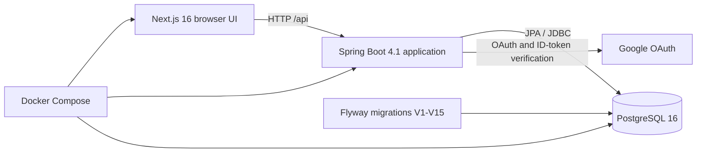

# Repository architecture audit

**Audit scope:** repository contents inspected on 2026-10-18. This document reports implementation evidence only. It does not assert that any command has been run successfully.

## Status legend

- **Verified**: directly present in source or configuration.
- **Inferred**: follows from verified code paths, but was not exercised against a running system.
- **Unknown**: requires deployment, database-history, or product-owner confirmation.

## Verified architecture

The repository is a pnpm workspace at the root with one actual Java application outside pnpm:

| Layer | Verified implementation | Build/runtime entry point |
|---|---|---|
| Frontend | Next.js 16.2, React 19, TypeScript, App Router, client-side `fetch`, React Query provider | [frontend/](../frontend/) `package.json` |
| Backend | Java 21, Spring Boot 4.1, Spring MVC, Spring Security, Spring Data JPA, Flyway, springdoc | [backend/](../backend/) `pom.xml` |
| Database | PostgreSQL 16; versioned SQL migrations V1-V15; Hibernate schema validation | [migration/](../backend/src/main/resources/db/migration/) |
| Local/container orchestration | `db`, `backend`, and `frontend` Compose services; named PostgreSQL volume | [docker-compose.yml](../docker-compose.yml) |

### Repository boundaries

- [package.json](../package.json) exposes the frontend pnpm development command. [backend/](../backend/) is a separate Maven application and is launched with its Maven wrapper as documented below.
- [frontend/Dockerfile](../frontend/Dockerfile) builds the frontend with pnpm 9.15.9 and starts Next standalone output on port 3000.
- [backend/Dockerfile](../backend/Dockerfile) builds a Maven JAR with Java 21 and runs it on port 8080. Image builds skip tests.
- [docker-compose.yml](../docker-compose.yml) injects container database, JWT, Google, CORS, and public API settings. It exposes PostgreSQL on 5432, the API on 8080, and the frontend on 3000.

## Backend implementation surface

Only three application domains have Spring MVC controllers:

| Domain | Entities/repositories | Service/controller | Persistence |
|---|---|---|---|
| Authentication | `User`, `UserRepository` | `AuthService`, `AuthController`, JWT filter/service | `users` |
| Landing sections | `LandingContent`, `LandingContentVersion` and repositories | `LandingContentController` | `landing_content`, `landing_content_versions` |
| Landing catalog | `LandingProject`, `LandingAchievement` and repositories | `LandingCatalogController` | `projects`, `achievements` |
| Module access | `AdminModule`, `RoleGuard` | `AuthController` module discovery | No additional tables |

All other migrated domains are schema-only at this revision: no Java entity, repository, service, controller, DTO, or frontend API client was found for them. See [schema-backed-unimplemented.md](modules/schema-backed-unimplemented.md).

Spring uses `/api` as its servlet context path. The Springdoc dependency supplies a runtime-derived OpenAPI endpoint/UI; no checked-in OpenAPI specification was found. [SwaggerConfig.java](../backend/src/main/java/com/neudebateclub/backend/config/SwaggerConfig.java) is empty.

## Database ownership and migration behavior

**Verified primary schema input:** [V1__create_enums.sql](../backend/src/main/resources/db/migration/V1__create_enums.sql) through [V17__seed_remaining_public_catalog_items.sql](../backend/src/main/resources/db/migration/V17__seed_remaining_public_catalog_items.sql), configured in [application.yml](../backend/src/main/resources/application.yml) as Flyway's migration location. [CREATE_NEU_DEBATE_CLUB.sql](../backend/src/main/resources/db/CREATE_NEU_DEBATE_CLUB.sql) is a `psql` bootstrap wrapper that includes that same ordered migration sequence; it is not an independent schema definition.

Hibernate is configured with `ddl-auto: validate`, so it validates rather than creates or changes tables. This makes the migration set the database schema authority in code.

**Important inferred operational behavior:** `baseline-on-migrate: true` with `baseline-version: 12` means an existing non-empty database without Flyway history can be marked as baseline 12, then receive V13-V15. This is only safe if that existing schema already matches the effects of V1-V12. The audit did not inspect a live database or its `flyway_schema_history` table.

## API and type ownership

| Concern | Current authority | Duplicates / limitation |
|---|---|---|
| Runtime endpoints | Spring controller mappings | No checked-in OpenAPI contract is generated from or validated against controllers. |
| API documentation | Springdoc at runtime, if the application starts | [DOCKER.md](../DOCKER.md) links to Swagger UI but does not enumerate endpoints. |
| Authentication DTOs | Java `AuthResponse` and `GoogleLoginRequest` | Handwritten frontend `AuthResponse` and `BackendUserDTO` repeat part of this contract. |
| Landing CMS payload | Untyped `JsonNode`/JSONB at the backend | Frontend `CmsSection`, `CmsCatalogItem`, and section component shapes are handwritten and do not share validation or generation. |
| Database schema | Flyway migrations | Java has mappings for only four tables (`users` plus the three CMS tables). |

## Configuration facts

- The root [`.env.docker.example`](../.env.docker.example) is the Compose template. [backend/.env.example](../backend/.env.example) and [frontend/.env.example](../frontend/.env.example) are direct-run templates. Actual `.env` files were deliberately not copied into this audit.
- A direct backend run defaults to the `local` profile through [application.yml](../backend/src/main/resources/application.yml); Compose sets `SPRING_PROFILES_ACTIVE` to `default` unless overridden, so [application-local.yml](../backend/src/main/resources/application-local.yml) is not selected by that default Compose setting.
- The direct backend template names `neudebateclub`; the root Compose template and backend default use `neu_debate_club`. These are distinct database names.
- The browser API URL is `NEXT_PUBLIC_API_BASE_URL`, defaulting to `http://localhost:8080/api`, and is baked into the frontend image build.

## Exact available build and verification commands

Run from the repository root in PowerShell. These are commands present in manifests or existing documentation; **they were not run during this documentation-only audit**.

| Layer | Install/build/verify commands | Notes |
|---|---|---|
| Frontend | `pnpm.cmd --dir frontend lint`  · `pnpm.cmd --dir frontend build` | PowerShell resolves this environment's `pnpm` shim through its execution policy; `pnpm.cmd` is the direct Windows command. No frontend `test` script or test runner configuration was found. |
| Backend | `Push-Location backend; .\mvnw.cmd test; Pop-Location`  · `Push-Location backend; .\mvnw.cmd package; Pop-Location` | The only discovered test is Spring context loading. Its configured datasource is PostgreSQL, so a suitable database and environment settings are required. |
| Full containers | `docker compose config --quiet`  · `docker compose up -d --build --wait --wait-timeout 180`  · `docker compose ps` | Existing [DOCKER.md](../DOCKER.md) records the same workflow and required root environment values. |
| Database migration integration | `docker compose up -d --build --wait --wait-timeout 180` | The backend starts Flyway then Hibernate validation; there is no separate migration-test script. |

## Known consistency risks

1. **Resolved in this change:** CMS client route strings now target the implemented controller mappings.
2. **Resolved in this change:** public project and achievement cards/list/detail pages now use the catalog endpoints; the obsolete static project module was removed. `landing_content.achievements` remains the source for landing-page statistics only.
   V16 copies the existing landing JSON seed into an empty catalog, while V17 adds the remaining public-page mock records without overwriting existing slugs.
3. **Corrected audit finding:** V9 already extends `department_enum` with `ky_thuat` and `nhan_su`, matching the Java enum.
4. The database contains many domain tables but the code implements only authentication and landing CMS. Dashboard routes predominantly import [MockPages.tsx](../frontend/src/components/dashboard/MockPages.tsx), so visible UI scope exceeds implemented API scope.
5. There is no shared or checked-in API contract and no client generation. Frontend catalog and CMS types remain handwritten.
6. Test coverage consists of one backend context-load test; no API, repository, migration, authentication, CMS, or frontend tests were found.

## Unknowns requiring evidence outside this checkout

- Whether deployed databases have complete V1-V12 schemas and valid Flyway history.
- Which of the database-defined domains are approved for implementation next.
- Whether `.ndc.neu@gmail.com` is the intended Google-login membership suffix, used by both backend role assignment and the frontend dashboard guard.
- Whether existing `landing_content` project/achievement item payloads should be retired after their catalog equivalents are verified in deployed data.
