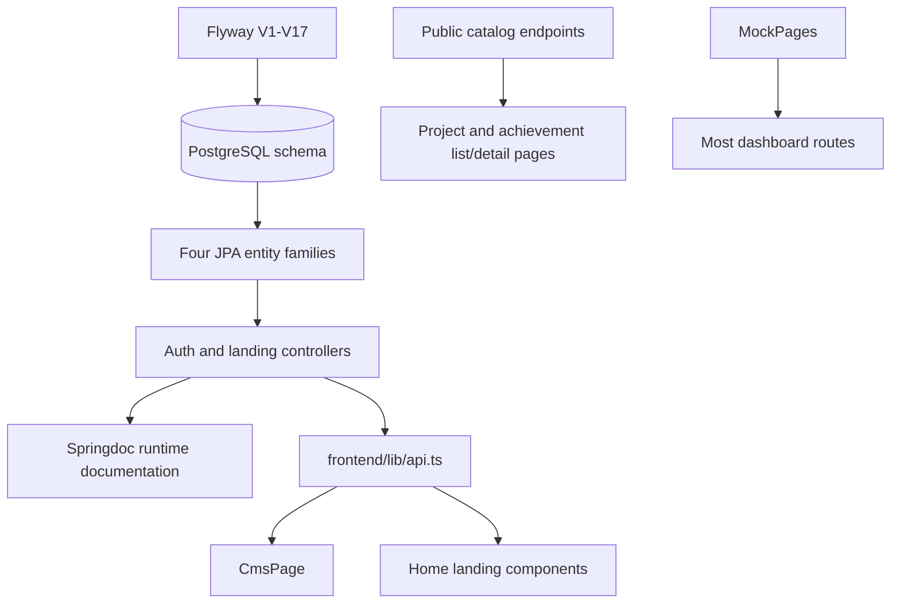

# Cross-layer dependency map

**Legend:** **Verified** means direct source evidence. **Inferred** follows from route and call composition but was not run. **Absent** means no source implementation was found.

## Executable endpoint map

All paths below include the verified Spring context path `/api`.

| Module | Backend endpoint | Controller backing it | Frontend caller | Status |
|---|---|---|---|---|
| Health | `GET /api/health` | `HealthController` | None found | Verified endpoint; not used by frontend. |
| Actuator health | `GET /api/actuator/health` | Spring Actuator | Compose health check | Verified. |
| Google redirect start | `GET /api/auth/google/authorize?returnUrl=...` | `AuthController` | `GoogleLoginButton` | Verified. |
| Google callback | `GET /api/auth/google/callback` | `AuthController` + `AuthService` | Google redirect target | Inferred external OAuth hop. |
| Google ID-token exchange | `POST /api/auth/google` | `AuthController` + `AuthService` | `exchangeGoogleIdToken`; no component call found | Verified endpoint; client helper is otherwise unused. |
| Current user | `GET /api/auth/me` | `AuthController` | `UserProvider` after callback token | Verified. |
| Accessible modules | `GET /api/auth/modules` | `AuthController` + `RoleGuard` | `UserProvider`, sidebar, dashboard route guard | Verified. |
| Logout | `POST /api/auth/logout` | `AuthController` | None; UI clears local storage | Verified endpoint; no server token revocation. |
| Published landing sections | `GET /api/public/landing` and `GET /api/public/landing/{section}` | `LandingContentController` | Home section components | Verified. |
| Public catalog rows | `GET /api/public/projects`, `GET /api/public/projects/{slug}`, `GET /api/public/achievements`, `GET /api/public/achievements/{slug}` | `LandingCatalogController` | Home/list/detail pages through `fetchPublicCatalog*` | Verified. |
| CMS section reads/writes | `GET /api/public/landing/cms/landing`, `GET /api/public/landing/cms/landing/{section}`, `PUT .../{section}/draft`, `POST .../{section}/publish`, `GET .../{section}/history` | `LandingContentController` | `api.ts` CMS helpers | Verified. |
| CMS catalog reads/publish | `GET /api/public/cms/landing/catalog/{type}`, `PUT .../{type}/publish` | `LandingCatalogController` | `api.ts` CMS helpers | Verified. |

## Implemented module traces

| Module | Database | Backend layers | Client/UI layers | Tests |
|---|---|---|---|---|
| Authentication | `users` created in V2; `google_id` added in V9 | `User` entity, `UserRepository`, `AuthService`, `JwtService`, filter, `AuthController`, DTOs | `GoogleLoginButton`, `UserProvider`, `api.ts` auth helpers, dashboard client guard | Context-load only; no auth behavior tests. |
| Landing JSON sections | `landing_content` in V7/V9; `landing_content_versions` in V13 | Two entities/repositories, `LandingContentController`, `LandingSection`, `RoleGuard` | Hero, Vision, Departments, Comments, and achievement statistics; `CmsPage`; handwritten `api.ts` types | No CMS tests. |
| Landing catalog | `projects` in V14; `achievements` in V15 | Two entities/repositories and `LandingCatalogController` | CMS and public home/list/detail pages through `api.ts` | No catalog tests. |

Detailed traces are in [auth.md](modules/auth.md) and [landing-cms.md](modules/landing-cms.md).
Dashboard access rules are documented in [access-control.md](modules/access-control.md).

## Schema-defined modules without application implementations

| Database area | Tables | Java/REST/frontend client | Evidence level |
|---|---|---|---|
| Seasons and membership | `seasons`, `season_members` | Absent | Verified absence from application source. |
| Tasks | `tasks`, `task_comments` | Absent; dashboard task routes render mock UI | Verified. |
| Announcements/notifications | `announcements`, `notifications` | Absent; dashboard notification routes render mock UI | Verified. |
| Events/checklists | `events`, `checklist_templates`, `checklist_template_items`, `event_checklist_items` | Absent | Verified. |
| Finance/partners | `transactions`, `partners`, `partner_contacts`, `outreach_logs`, `collaborations` | Absent; finance route renders mock UI | Verified. |
| Media/activity | `media_links`, `activity_logs` | Absent; publication/activity routes render mock UI | Verified. |
| Event content/proposals | `event_contents`, `proposals` | Absent | Verified. |
| Attendees/check-in | `event_attendees` | Absent | Verified. |
| Equipment | `equipment`, `equipment_borrows` | Absent | Verified. |
| Design assets | `design_assets` | Absent | Verified. |

See [schema-backed-unimplemented.md](modules/schema-backed-unimplemented.md) for migration provenance and planning implications.

## Data and contract dependencies

The arrows from migration to PostgreSQL and from controller to runtime OpenAPI are verified configuration relationships. Project and achievement UI paths now use the public catalog endpoints. Dashboard mock pages still bypass the API entirely.

## Contract authority decision record

No formal decision record exists in the repository. The audit records the current practical order of authority:

1. **Database schema:** Flyway migration files, with the bootstrap wrapper invoking them.
2. **Backend runtime API:** Spring controller mappings and DTO/entity serialization.
3. **Runtime API documentation:** springdoc-generated output when the server is available.
4. **Frontend types:** handwritten and therefore downstream, non-authoritative representations.

This is a verified description of current mechanics, not a recommendation that JSONB payloads or entities should remain public contracts.
