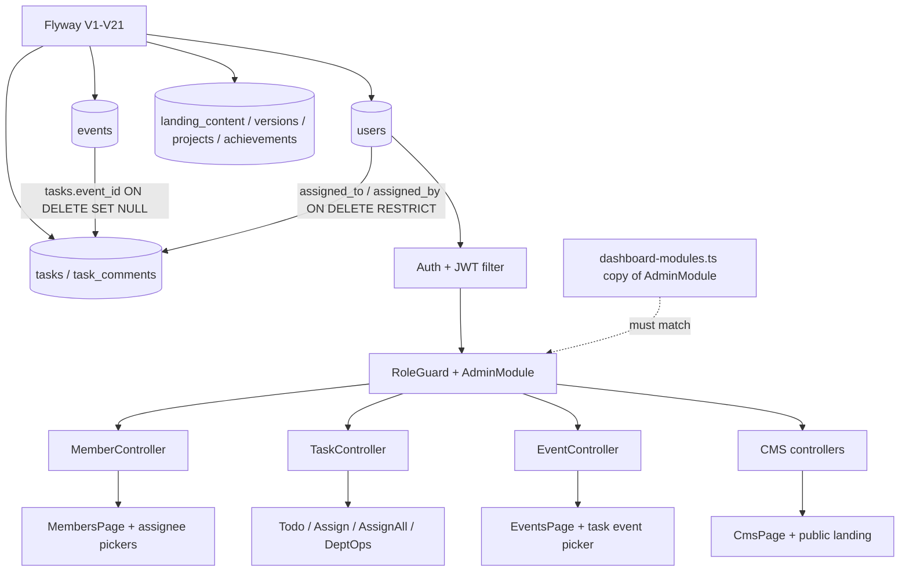

# Cross-layer dependency map

**Audit date:** 2026-11-13 (commit `f3033a5`). **Legend:** **Verified** = direct source evidence. **Inferred** = follows from code composition, not exercised. **Absent** = no implementation found.

All paths include the Spring context path `/api`. "Auth" column: `public` = permitted by `SecurityConfig`; otherwise a valid JWT is required, plus the controller-level check shown.

## Endpoint inventory (verified: 40 application routes plus actuator/springdoc)

### Auth — [AuthController](../backend/src/main/java/com/neudebateclub/backend/auth/AuthController.java)

| Method & path | Auth | Frontend caller |
|---|---|---|
| `GET /auth/google/authorize?returnUrl=` | public | [GoogleLoginButton](../frontend/src/features/auth/GoogleLoginButton.tsx) (browser navigation) |
| `GET /auth/google/callback` | public; requires valid signed `state` + matching `ndc_oauth_nonce` cookie | Google redirect target; redirects to frontend with single-use `authCode` + `loginSuccess`, or `googleError` |
| `POST /auth/google/exchange` | public (single-use code, 60 s) | `exchangeLoginCode` ← `userContext.tsx` (added 2026-11-13) |
| `POST /auth/google` | public | `exchangeGoogleIdToken` → `completeGoogleLogin` in [userContext.tsx](../frontend/src/context/userContext.tsx) |
| `GET /auth/me` | JWT | `userContext.tsx` (direct `fetch`, not via `api.ts`) |
| `GET /auth/modules` | JWT | `fetchAccessibleModules` |
| `POST /auth/logout` | public | None — the UI only clears `localStorage` |

### Members — [MemberController](../backend/src/main/java/com/neudebateclub/backend/user/MemberController.java)

| Method & path | Controller check | Frontend caller |
|---|---|---|
| `GET /members` | `TRUONG_BAN`+ ; non-BCN sees own department only; GUEST rows hidden | `fetchMembers` ← MembersPage, AssignTaskPage, AssignAllTasksPage, DepartmentOperationsPage (MockPages) |
| `POST /members` | module `MEMBERSHIP` | `createMember` ← MembersPage |
| `PUT /members/{id}` | module `MEMBERSHIP`; only BCN may edit/grant BCN | `updateMember` ← MembersPage |
| *(delete)* | Absent | — |

### Tasks — [TaskController](../backend/src/main/java/com/neudebateclub/backend/task/TaskController.java)

| Method & path | Controller check | Frontend caller |
|---|---|---|
| `GET /tasks?department&status&priority` | BCN all; lead own department (else 403); member own assigned tasks | `fetchTasks` ← AssignTaskPage (with `department`), AssignAllTasksPage, DepartmentOperationsPage |
| `GET /tasks/mine` | `MEMBER`+ ; assignee = caller | `fetchMyTasks` ← TodoListPage |
| `GET /tasks/{id}` | assignee, BCN, or lead of the task's department | None |
| `POST /tasks` | module `TASK_ASSIGNMENT` (lead: own department); all-departments needs `CROSS_DEPARTMENT_TASKS` | `createTask` ← AssignTaskPage, AssignAllTasksPage |
| `PUT /tasks/{id}` | module `TASK_ASSIGNMENT` + own department (BCN any) | `updateTask` — **no caller** |
| `PATCH /tasks/{id}/status` | `MEMBER`+ ; assignee, BCN, or same-department TRUONG_BAN | `updateTaskStatus` ← AssignAllTasksPage |
| `GET /tasks/{id}/comments` | same viewer rule as above | `fetchTaskComments` ← [TaskHistory](../frontend/src/components/dashboard/TaskHistory.tsx) |
| `PATCH /tasks/{id}/progress` | assignee only | `updateTaskProgress` ← TodoListPage |
| `DELETE /tasks/{id}` | module `TASK_ASSIGNMENT` + own department (BCN any) | `deleteTask` ← AssignAllTasksPage |

### Events — [EventController](../backend/src/main/java/com/neudebateclub/backend/event/EventController.java)

| Method & path | Controller check | Frontend caller |
|---|---|---|
| `GET /events` | `MEMBER`+ | `fetchEvents` ← EventsPage, AssignTaskPage, AssignAllTasksPage |
| `POST /events` | module `EVENT_MANAGEMENT` | `createEvent` ← EventsPage |
| `PUT /events/{id}` | module `EVENT_MANAGEMENT` | `updateEvent` ← EventsPage |
| `DELETE /events/{id}` | module `EVENT_MANAGEMENT` | `deleteEvent` ← EventsPage |

### Landing sections — [LandingContentController](../backend/src/main/java/com/neudebateclub/backend/cms/LandingContentController.java)

| Method & path | Check | Frontend caller |
|---|---|---|
| `GET /public/landing` | public | None |
| `GET /public/landing/{section}` | public | `fetchLandingSection` ← Hero, Vision, Departments, Comments, Achievements (stats) |
| `GET /public/landing/cms/landing` | public at filter, module `LANDING_CMS` in controller | `fetchCmsSections` ← CmsPage |
| `GET /public/landing/cms/landing/{section}` | same | `fetchCmsSection` ← CmsPage |
| `PUT /public/landing/cms/landing/{section}/draft` | JWT + `LANDING_CMS` | `saveCmsDraft` ← CmsPage |
| `POST /public/landing/cms/landing/{section}/publish` | JWT + `LANDING_CMS` | `publishCmsSection` ← CmsPage |
| `GET /public/landing/cms/landing/{section}/history` | `LANDING_CMS` | `fetchCmsHistory` — **no caller** |

### Catalog — [LandingCatalogController](../backend/src/main/java/com/neudebateclub/backend/cms/LandingCatalogController.java)

| Method & path | Check | Frontend caller |
|---|---|---|
| `GET /public/projects`, `GET /public/projects/{slug}` | public | `fetchPublicCatalog`, `fetchPublicCatalogItem` ← home Projects, `/projects`, `/projects/[slug]` |
| `GET /public/achievements`, `GET /public/achievements/{slug}` | public | same helpers ← home Achievements, `/achievements`, `/achievements/[slug]` |
| `GET /public/cms/landing/catalog/{type}` | `LANDING_CMS` | `fetchCmsCatalog` ← CmsPage |
| `GET /public/cms/landing/catalog/{type}/slug-available` | `LANDING_CMS` | `checkCmsCatalogSlug` ← CmsPage |
| `PUT /public/cms/landing/catalog/{type}/publish` | JWT + `LANDING_CMS` | `publishCmsCatalog` ← CmsPage |

### Operations

| Method & path | Check | Caller |
|---|---|---|
| `GET /health` | **JWT required** (not in `permitAll`) | None |
| `GET /actuator/health` | public | Compose health check |
| `GET /actuator/{info,metrics,mappings}` | JWT (exposed, not permitted) | None |
| `GET /v3/api-docs`, `/swagger-ui.html` | public | None (runtime OpenAPI) |

Note: CMS admin routes live under the `/public` prefix and rely on controller checks; their `GET`s pass the security filter anonymously and return 403 from `RoleGuard`, not 401.

### Notifications — [NotificationController](../backend/src/main/java/com/neudebateclub/backend/notification/NotificationController.java)

| Method & path | Controller check | Frontend caller |
|---|---|---|
| `GET /notifications?limit=` | `MEMBER`+; caller's own rows only; limit 1–100 (default 50) | `fetchNotifications` ← NotificationBell, ReadNotificationPage |
| `POST /notifications` | module `NOTIFICATION_MANAGEMENT`; BCN: all/departments/members; lead: own department or its members | `createNotification` ← CreateNotificationPage |

`POST /tasks` also writes a `TASK_ASSIGNED` notification per created task. Detail: [notifications.md](modules/notifications.md).

## Module traces

| Module | DB (migration) | Entity / repo | Controller & DTOs | Frontend client → UI | Tests |
|---|---|---|---|---|---|
| Auth | `users` V2, `google_id` V9 | `User`, `UserRepository` | `AuthController`, `AuthService`; `AuthResponse`, `GoogleLoginRequest` (classes) | `api.ts` auth helpers, `userContext.tsx`, `GoogleLoginButton`, `DashboardAccessGuard`, `Sidebar` | `AuthServiceTest` (2), `RoleGuardTest` (3) |
| Members | `users` V2 (+V18 seed) | `User`, `UserRepository` | `MemberController`; nested records `MemberRequest`, `MemberResponse` | `Member`, `CreateMemberInput` in `api.ts` → [MembersPage](../frontend/src/components/dashboard/MembersPage.tsx) | `MemberControllerTest` (5) |
| Tasks | `tasks`, `task_comments` V3; `event_id` V9; `progress` V21 | `Task`, `TaskComment`, two repos | `TaskController`; nested `CreateTaskRequest`, `UpdateTaskRequest`, `UpdateStatusRequest`, `UpdateProgressRequest`, `TaskResponse`, `TaskCommentResponse` | `BackendTask`, `CreateTaskPayload`, `UpdateTaskPayload`, `TaskComment` → TodoListPage, AssignTaskPage, AssignAllTasksPage, TaskHistory, DepartmentOperationsPage | `TaskControllerTest` (14) |
| Events | `events` V5; `resource_urls` V19 (+V20 seed) | `Event`, `EventRepository` | `EventController`; nested `EventRequest`, `EventResponse` | `ClubEvent`, `SaveEventInput` → [EventsPage](../frontend/src/components/dashboard/EventsPage.tsx); event pickers in task pages | `EventControllerTest` (4) |
| Landing sections | `landing_content` V7/V9, versions V13 (+V10–V12 seed) | 2 entities/repos | `LandingContentController`; untyped `JsonNode`/`Map` | `CmsSection`, `CmsHistoryItem`; section shapes declared per component | `CmsPublishIntegrationTest` (opt-in) |
| Catalog | `projects` V14, `achievements` V15 (+V16–V17 seed) | 2 entities/repos | `LandingCatalogController`; entities serialized directly | `CmsCatalogItem` → CmsPage, public pages | `CmsPublishIntegrationTest` (opt-in) |
| Notifications | `notifications` V4 + `created_by` V22 | `Notification`, `NotificationRepository`, `NotificationService` | `NotificationController`; nested `CreateNotificationRequest`, `NotificationResponse`, `CreateNotificationResponse` | `AppNotification`, `CreateNotificationPayload` → NotificationBell, NotificationPages | `NotificationServiceTest` (9) |
| Module access | none | — | `AdminModule`, `RoleGuard`, `/auth/modules` | [dashboard-modules.ts](../frontend/src/constants/dashboard-modules.ts) | `RoleGuardTest` |

Per-module detail: [auth.md](modules/auth.md), [members.md](modules/members.md), [tasks.md](modules/tasks.md), [events.md](modules/events.md), [landing-cms.md](modules/landing-cms.md), [access-control.md](modules/access-control.md), [database-migrations.md](modules/database-migrations.md).

## Dependency graph

**Critical cross-layer couplings (verified):**

1. **`users` is the hub.** Auth, members, tasks (assignee/assigner, `ON DELETE RESTRICT`), events (`created_by`), CMS (`updated_by`/`created_by`) all reference it. Any change to role/department semantics touches every module.
2. **`AdminModule` is declared twice** — Java enum and the `ADMIN_MODULE_KEYS` tuple in `dashboard-modules.ts`. The 14 keys currently match exactly; nothing enforces that.
3. **Enum string casing** — the frontend upper-cases department/status/priority before sending and accepts both casings back because the backend mixes lowercase (`/auth/me`) and uppercase (all other DTOs).
4. **Tasks depend on events** (`eventId`); an unknown `eventId` is silently dropped to `null` rather than rejected.
5. **Task "department lead" resolution** uses `LIMIT 1` native queries on `users`; with multiple `TRUONG_BAN` in one department the chosen lead is non-deterministic, and with none it falls back to any active member, then to the assigner.

## Schema-only areas (no entity, API, or client)

| Area | Tables | Migration | UI |
|---|---|---|---|
| Tenure | `seasons`, `season_members` | V2, V8 trigger | `/dashboard/tenure` → MockPages |
| Announcements | `announcements` | V4 | none |
| Event checklists | `checklist_templates`, `checklist_template_items`, `event_checklist_items` | V5 | none |
| Finance & partners | `transactions`, `partners`, `partner_contacts`, `outreach_logs`, `collaborations` | V6, V8 trigger, V9 | `/dashboard/finance` → MockPages |
| Media & activity | `media_links`, `activity_logs` | V7 | `/dashboard/publications`, `/dashboard/activity-log` → MockPages |
| Content pipeline | `event_contents`, `proposals` | V9 | none |
| Check-in | `event_attendees` | V9 | none |
| Equipment | `equipment`, `equipment_borrows` | V9 | none |
| Design assets | `design_assets` | V9 | `/dashboard/library` → MockPages |

Unused Java enums tied to these tables: `ChecklistStatus`, `ContentStatus`, `OutreachResult`, `PartnerStatus`, `Platform`, `TransactionType`. See [schema-backed-unimplemented.md](modules/schema-backed-unimplemented.md).

## Dashboard route → implementation

| Route | Component | Data |
|---|---|---|
| `/dashboard` | `DashboardHomePage` (MockPages) | static |
| `/dashboard/tasks` | `TasksHubPage` (MockPages) | static |
| `/dashboard/tasks/todo-list` | TodoListPage | live (`?task=<id>` opens that task) |
| `/dashboard/notifications/read` | ReadNotificationPage (NotificationPages) | live (`?id=<id>` selects one) |
| `/dashboard/notifications/create` | CreateNotificationPage (NotificationPages) | live |
| `/dashboard/tasks/update` | server `redirect` → todo-list | — (not in access map; guard would also redirect) |
| `/dashboard/tasks/assign` | AssignTaskPage | live |
| `/dashboard/tasks/assign-all` | AssignAllTasksPage | live (also contains an unused `INITIAL_SAMPLE_TASKS` constant) |
| `/dashboard/department-operations` | `DepartmentOperationsPage` (MockPages) | **mixed**: live members/tasks + static sections |
| `/dashboard/members` | MembersPage | live |
| `/dashboard/events` | EventsPage | live |
| `/dashboard/cms` | CmsPage | live |
| `/dashboard/roles` (module `MEMBERSHIP`) | `RolesPage` (MockPages) | static |
| `/dashboard/charts`, `/health-dashboard`, `/activity-log`, `/finance`, `/library`, `/publications`, `/tenure` | MockPages | static |
| `/departments/[slug]` (public) | page component | no API call found |

## Contract authority (current practice, not a decision)

1. **Database schema:** Flyway SQL files.
2. **Runtime API:** Spring controller mappings + nested record DTOs (and, for catalog, JPA entities).
3. **API documentation:** springdoc at runtime only; no checked-in OpenAPI file.
4. **Frontend types:** handwritten in [api.ts](../frontend/src/lib/api.ts); downstream and unchecked.
