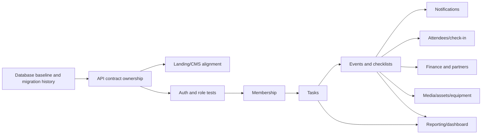

# NEU Debate Club master plan

## Purpose and baseline

This plan starts from the repository's verified state, not from the broader product documents. The executable system currently covers Google-backed authentication plus landing-page/CMS persistence. PostgreSQL migrations describe a wider future system; the dashboard exposes mostly static mock screens for it.

Detailed evidence is retained in [architecture.md](architecture.md), [dependency-map.md](dependency-map.md), [auth.md](modules/auth.md), [landing-cms.md](modules/landing-cms.md), and [schema-backed-unimplemented.md](modules/schema-backed-unimplemented.md).

## Current module register

| Module | Database | Backend API | Frontend | Test coverage | Status |
|---|---|---|---|---|---|
| Google authentication | `users` | Implemented | Implemented | Context only | Partial vertical slice |
| Dashboard module access | Existing `users.role` and `users.department` | `AdminModule`, `RoleGuard`, `/auth/modules` | Module-filtered navigation and route guard | RoleGuard unit test | Implemented |
| Landing section CMS | `landing_content`, versions | Implemented | CMS client paths aligned; home owns independent landing sections/statistics | Opt-in PostgreSQL HTTP publish/read/history tests | Partial vertical slice |
| Landing catalog | `projects`, `achievements` | Implemented | CMS and public project/achievement pages use catalog APIs | Opt-in PostgreSQL HTTP publish/rollback tests | Partial vertical slice |
| Tasks, events, announcements, members, finance, partners, media, check-in, equipment, assets | Schema tables exist | Not implemented | Mock/static pages or absent | None | Planned only |

## Prioritized implementation order

This is a proposed order to close verified gaps. It is not approval to change application behavior.

1. **Establish a reproducible baseline.** Confirm the target database's Flyway history and schema state, select one local-development database name/profile convention, and record a non-production migration verification procedure. Do not edit applied migrations.
2. **Choose and publish the API-contract workflow.** Decide whether controller-derived OpenAPI is exported and reviewed, or a checked-in OpenAPI file becomes authoritative. Generate frontend types from the chosen contract only after this decision.
3. **Protect the repaired landing vertical slice.** Add API and UI tests covering catalog reads, CMS authorization, draft, publish, and errors. Retire legacy project/achievement JSON only after deployed data is verified.
4. **Harden identity and authorization.** Confirm the membership domain rule, remove duplicated/ambiguous role decisions through an agreed contract, and add auth integration coverage before expanding privileged APIs.
5. **Build the operational core as complete vertical slices.** Start with users/membership and tasks, because later workflow, notification, and reporting modules depend on user identity and assignments. Implement schema mapping, DTO/API, client behavior, and tests together.
6. **Add event operations and notifications.** Implement events/checklists before attendee check-in, finance attribution, media links, and content approvals because those tables reference events.
7. **Add department operations.** Sequence partner/finance, media/design assets, equipment, and proposals according to confirmed club priorities. Each needs explicit roles, lifecycle rules, and an API contract before its existing mock screen becomes live.
8. **Add reporting only after source workflows.** Dashboard charts, health views, and activity analytics should consume completed operational data rather than duplicate mock-derived calculations.

## Cross-layer prerequisites

## Immediate consistency backlog

| Priority | Verified gap | Completion evidence |
|---|---|---|
| Closed | CMS frontend route strings did not match controller mappings. | Frontend helpers now call the concrete controller route prefixes. |
| Closed | Public projects/achievements had independent JSON-section, catalog-table, and static-page representations. | Catalog endpoints now supply all public project and achievement cards/list/detail pages; static project data was removed. |
| P0 | Flyway baseline policy can skip V1-V12 for an existing untracked schema. | Target environment migration history/schema is inspected and a safe onboarding procedure is documented. |
| Closed | Java department values appeared to exceed the PostgreSQL enum values. | V9 already extends the enum; documentation corrected. |
| Closed | Root pnpm backend scripts did not correspond to the Maven backend. | Invalid backend workspace scripts were removed; Maven remains the documented backend entry point. |
| P1 | API types are handwritten on both sides. | One selected contract workflow detects backend/frontend drift in CI. |
| P1 | Domain dashboard pages present mock content for schema-only modules. | Each page is labelled as mock until its API vertical slice is implemented, or is replaced per product decision. Module visibility is now centrally filtered by department access. |
| P2 | CMS now has opt-in PostgreSQL integration coverage; auth behavior and frontend UI coverage remain incomplete. | Run CMS tests against a disposable database in CI and add coverage for the remaining contracts. |

## Assumptions requiring owner confirmation

1. Is `.ndc.neu@gmail.com` the intended membership suffix for both Google authorization and dashboard access?
2. Is the target database already populated, and if so, does it contain Flyway history through V12?
3. Which schema-only domain is the next approved product vertical slice after landing/auth stabilization?
4. Should runtime springdoc output remain the API documentation mechanism, or should a versioned OpenAPI specification be introduced?

## Audit constraints and result

This master plan began as a documentation audit. The catalog/CMS alignment changes recorded above modify application code and add forward-only seed migrations; they do not edit applied migrations, install dependencies, or modify production configuration. The remaining contract, test, and schema-only-module risks remain open work.
