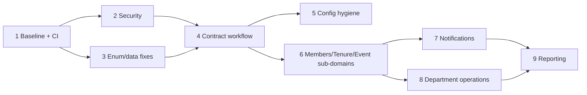

# NEU Debate Club — master plan

**Baseline:** commit `f3033a5` on `main`, audited 2026-11-13. This plan starts from what the repository verifiably does, not from the product documents. Generating these documents does **not** mean the repository is consistent; the open risks below are real and unresolved.

Evidence: [architecture.md](architecture.md) · [dependency-map.md](dependency-map.md) · modules: [auth](modules/auth.md) · [access-control](modules/access-control.md) · [members](modules/members.md) · [tasks](modules/tasks.md) · [events](modules/events.md) · [landing-cms](modules/landing-cms.md) · [database-migrations](modules/database-migrations.md) · [schema-only](modules/schema-backed-unimplemented.md)

## Actual architecture (one paragraph)

A Next.js 16 client-rendered frontend calls a Spring Boot 4.1 / Java 21 REST API under `/api` with a Google-OAuth-issued JWT. The API uses Spring Data JPA directly from controllers (no service layer except auth) against PostgreSQL 16, whose schema is owned by Flyway SQL migrations V1–V21 with Hibernate in `validate` mode. 8 of 28 tables are mapped. API contracts are implicit in controller records; frontend types in `api.ts` are handwritten copies. There is no CI and no frontend test runner.

## Module register

| Module | DB | Backend API | Frontend | Tests (run 2026-11-13) | Status |
|---|---|---|---|---|---|
| Google auth + JWT | `users` | 6 routes | login flow, context, guard | AuthServiceTest 2 ✔ | Working slice; security gaps A-1, A-2 |
| Module access | none | `/auth/modules`, `RoleGuard` | sidebar + route guard | RoleGuardTest 3 ✔ | Working; task APIs don't use it |
| Members | `users` (+V18 seed) | list/create/update | MembersPage, pickers | MemberControllerTest 5 ✔ | Partial (no delete, no tenure) |
| Tasks | `tasks`, `task_comments` | 9 routes | todo, assign, assign-all, history | TaskControllerTest 6 ✔ | Partial; authorization gaps T-1…T-3 |
| Events | `events` (+V20 seed) | CRUD | EventsPage, task pickers | EventControllerTest 4 ✔ | Partial (subset of columns) |
| Landing sections | `landing_content`, versions | public + CMS | home sections, CmsPage | CMS integration — not run | Working slice |
| Landing catalog | `projects`, `achievements` | public + CMS | home, list/detail, CmsPage | CMS integration — not run | Working slice |
| Notifications | `notifications` V4 (+`created_by` V22) | 2 routes + task-create hook | bell, read page, create page | NotificationServiceTest 9 ✔ | Implemented 2026-11-13 (uncommitted); see [notifications.md](modules/notifications.md) |
| Finance | `transactions` | 3 routes (`/finance/transactions`) | FinancePage | FinanceControllerTest 6 ✔ | Implemented 2026-11-13 (list/add/delete), uncommitted |
| Publications + library | `media_links`, `events.resource_urls` | 3 routes (`/publications`) | PublicationsPage, LibraryPage (merged links, read-only) | PublicationControllerTest 5 ✔ | Implemented 2026-11-13, uncommitted |
| Tenure | `seasons`, `season_members` | 6 routes (`/seasons`) | TenurePage | SeasonControllerTest 7 ✔ | Implemented 2026-11-13, uncommitted |
| Activity log | `activity_logs` | `GET /activity-logs` (BCN) + writes from every write endpoint | ActivityLogPage | ActivityLogControllerTest 3 ✔ | Implemented 2026-11-13, uncommitted |
| Partners/outreach, checklists, proposals, check-in, equipment, design assets, announcements, media, activity log, checklists, proposals, check-in, equipment, design assets | 20 tables | none | mock pages or none | none | Schema only |
| Dashboard home, tasks hub, charts, health, roles, department ops | n/a | existing APIs | real-data pages; `MockPages.tsx` deleted 2026-11-13 | `taskMetrics`/`financeMetrics` node tests | Live (uncommitted). Undefined metrics (health score, contribution score, budget, approvals) removed by owner decision; roles matrix is editable by BCN since 2026-11-13 (`module_permissions`, V23) |

## Risk register

Severity: **P0** = data loss, security exposure, or deploy blocker; **P1** = wrong behaviour / contract drift; **P2** = hygiene. All entries are verified in source unless the "Evidence" column says otherwise.

| ID | Sev | Risk | Evidence | Detail |
|---|---|---|---|---|
| ~~R-1~~ | P0 | Open-redirect / token leak via OAuth `state`/`returnUrl` and JWT in query string. **Fixed 2026-11-13 (commit 3bcc82c):** safe relative return path, signed state bound to an HttpOnly nonce cookie, single-use 60 s login code redeemed by `POST /auth/google/exchange`. Covered by `GoogleLoginFlowTest`; not yet exercised end-to-end against Google. | Verified by unit tests | [auth](modules/auth.md#risks) |
| ~~R-2~~ | P0 | Task authorization gaps. **Fixed 2026-11-13 (commit 3bcc82c)** per owner decision 3 (strict). Covered by 8 new `TaskControllerTest` cases using the real `RoleGuard`. | Verified by unit tests | [tasks](modules/tasks.md#verified-gaps) |
| ~~R-16~~ | P1 | Native queries bound Java enums directly (`CAST(:department AS text)`), so every `GET /tasks` filter and the department-lead lookup matched nothing: leads saw 0 tasks and BCN tasks for a department fell back to the BCN user. **Fixed 2026-11-13** with SpEL `:#{#department?.name()}` in `TaskRepository`/`UserRepository`; verified against the Docker DB. | Verified at runtime | `TaskRepository.findWithFilters`, `UserRepository.findFirst*` |
| R-17 | P1 | Local Docker `JWT_SECRET` is only 7 characters; any production secret must be long and random. | Verified (length only) | `.env` |
| R-18 | P2 | Malformed JSON bodies and unknown paths return 500 (`HttpMessageNotReadableException`, `NoResourceFoundException` hit the catch-all handler). Part of step 4. | Verified at runtime | `GlobalExceptionHandler` |
| ~~R-15~~ | P0 | `JWT_SECRET` values that are not valid Base64 (e.g. containing `-`, as in `.env.docker.example`) crashed token signing: `DecodingException` was not caught. **Fixed 2026-11-13 (commit 3bcc82c).** | Verified by unit test | `JwtService.getSigningKey` |
| R-3 | P0 | Applied migrations V1, V2, V12 were edited after first commit; older databases will fail checksum validation and may keep `users.google_id NOT NULL` or lack catalog enums. `baseline-version: 12` can mask this. | Verified git; DB state unknown | [database-migrations](modules/database-migrations.md) |
| R-4 | P0 | Sample members, events and a fixed BCN account are seeded by versioned migrations and will land in production. | Verified | [database-migrations](modules/database-migrations.md#other-observations) |
| R-5 | P1 | Java `TaskStatus.BLOCKED/CANCELLED`, `TaskPriority.URGENT` silently persisted as `todo`/`high`. | Verified | [tasks T-5](modules/tasks.md#verified-gaps) |
| R-6 | P1 | No API contract artefact; `api.ts` types, `AdminModule` keys and enum casing are hand-synchronised; mixed lowercase/uppercase enums and mixed response envelopes. | Verified | [dependency-map](dependency-map.md#dependency-graph) |
| ~~R-7~~ | — | Login overwrites `full_name`/`avatar_url` from Google. **Closed: intended (owner decision 5).** | Verified | [auth A-4](modules/auth.md#risks) |
| R-8 | P1 | Malformed body / bad enum query param → HTTP 500 (no handler). | Inferred from handler set | [architecture](architecture.md#backend-structure-verified) |
| R-9 | P1 | Three default DB names (`neu_debate_club`, `neudebateclub`, `clubhub`); `ALLOWED_DOMAIN` documented but unused; `GET /health` requires auth. | Verified | [architecture](architecture.md#configuration-verified) |
| R-10 | P2 | Dashboard protection is client-side only: `UserProvider` redirects anonymous visitors to `/` after the session check (static pages may flash first); `middleware.ts` is a no-op. *Corrected 2026-11-13 — the first audit wrongly said anonymous visitors were not redirected.* | Verified | [access-control](modules/access-control.md#frontend-enforcement-verified) |
| R-11 | P1 | No CI; frontend lint currently fails (1 error); no frontend tests; `BackendApplicationTests` runs Flyway against whatever DB is configured. | Verified by running | [architecture](architecture.md#build-and-test-commands) |
| R-12 | P2 | Frontend manifest omits `react`/`react-dom`; two pnpm lockfiles/workspace files; unused `h2` dependency; empty config classes; stray `test.json`/`test.txt`; tracked empty `frontend/src/.env.local`. | Verified | [architecture](architecture.md#configuration-verified) |
| R-13 | P2 | Product docs diverge from code: suffix rule unenforced, `members` table vs `users`, `IMPLEMENTATION_ROADMAP.md` still lists UC-14/UC-09 as not started. | Verified | [members M-6](modules/members.md) |
| R-14 | P2 | Dashboard mixes live and mock content (DepartmentOperationsPage) without labelling which is which. | Verified | [dependency-map](dependency-map.md#dashboard-route--implementation) |

Closed since the 2026-10-18 audit (verified): CMS route alignment; catalog as single source for projects/achievements; department enum parity; invalid root backend scripts removed.

## Proposed implementation order

A proposal only — not approval to change behaviour. Each step lists what proves it is done.

1. **Establish a safe baseline (R-3, R-4, R-11).**
   Inspect every real database read-only using the queries in [database-migrations.md](modules/database-migrations.md#safe-verification-procedure-proposed-not-executed). Decide per environment between `flyway repair` and forward-fix migrations. Freeze V1–V21 (no more edits). Decide where sample data belongs: a Flyway location enabled only for local/dev, or a separate script. Add a disposable-DB CI job running `mvnw test` plus `tsc --noEmit` and `lint`.
   *Done when:* CI is green on a fresh Postgres, and each environment's history is recorded.
2. **Close security gaps (R-1, R-2).** — *Implemented 2026-11-13 (commit 3bcc82c), unit-tested; not yet tested end-to-end with real Google login.*
   Validate `returnUrl` as a relative path. Replace raw `state` with a signed nonce. Move the token off the URL (one-time code or HttpOnly cookie). Apply the decided task-visibility rule (owner decision 3, option A): members read only their own tasks, leads read and write only their department's tasks, and only BCN may assign to all departments.
   *Done when:* controller/integration tests cover each boundary listed in [tasks.md](modules/tasks.md) T-1…T-3 and [auth.md](modules/auth.md) missing coverage.
3. **Fix silent data corruption (R-5).**
   Add a forward migration (**V24** — V22 is taken by notifications, V23 by `module_permissions`) extending `task_status_enum` with `blocked`, `cancelled` and `task_priority_enum` with `urgent` (owner decision 4). Map them in the converters, make converters throw on unknown values, and add them to the frontend task types and UI.
4. **Contract workflow (R-6, R-8) — decided: springdoc-generated (owner decision 6).**
   Export `/v3/api-docs` in CI and generate frontend TypeScript types from it. Standardise the `ApiResponse` envelope and enum casing. Add handlers for `HttpMessageNotReadableException` and `MethodArgumentTypeMismatchException`.
   *Done when:* a backend DTO change breaks the frontend type-check.
5. **Configuration and frontend hygiene (R-9, R-10, R-12).**
   Use one DB name. Remove or implement `ALLOWED_DOMAIN`. Permit or remove `/health`. Add an auth redirect for anonymous dashboard access. Declare `react`/`react-dom`. Pick one lockfile. Fix the lint error.
6. **Extend core vertical slices.**
   Finish members (deactivate flow, student-id unique constraint) → tenure (`seasons`) → event sub-domains (checklists, then attendees/check-in). Introduce a service layer for any slice that adds business rules.
7. **Notifications** — *v1 implemented early on 2026-11-13 at the owner's request (in-app only, task-created hook, manual send); see [notifications.md](modules/notifications.md). PWA push and deadline reminders remain.*
8. **Department operations** (finance/partners, media/publications, design assets, equipment, proposals), ordered by confirmed club priority. Each needs an `AdminModule` check and an API contract before its mock page goes live.
9. **Reporting last** (charts, health dashboard, activity log), consuming real data from steps 6–8. Label or remove mock content until then (R-14).
10. **Reconcile product docs (R-13)** after each step, rather than in bulk.

## Owner decisions (confirmed 2026-11-13)

| # | Question | Decision | Effect on this plan |
|---|---|---|---|
| 1 | Does a non-local database exist? | **No.** Only local development databases. | R-3 and R-4 drop from production risks to "must fix before the first deployment". Local databases that fail checksum validation can be recreated. |
| 2 | Require the `*.ndc.neu@gmail.com` suffix at login? | **No.** It was used before; it is no longer the rule. "Present and active in `users`" is the rule. | Current code is correct. Remove `ALLOWED_DOMAIN` from env templates and update the use-case document (R-13). |
| 4 | Keep `BLOCKED`, `CANCELLED`, `URGENT`? | **Yes.** | Add a forward migration extending `task_status_enum` and `task_priority_enum`, fix the converters and frontend types (R-5). |
| 5 | Should Google overwrite name/avatar on login? | **Yes.** | Intended behaviour; R-7 closed. |
| 3 | Task visibility | **Option A (strict):** a member reads only tasks assigned to them; a department lead reads only their department's tasks; BCN reads all. Writes: a lead edits/deletes only their own department's tasks; only BCN may assign to all departments. | Defines the fix for R-2 (step 2). `GET /tasks` and `GET /tasks/{id}` must be scoped server-side; DepartmentOperationsPage must stop relying on client-side filtering. |
| 6 | API contract workflow | **Option A:** the springdoc-generated OpenAPI (from Java controllers) is the source of truth; it is exported in CI and TypeScript types are generated from it for the frontend. | Defines step 4. Handwritten types in `api.ts` are replaced by generated types; backend DTO changes must break the frontend type-check. |
| 7 | Next domain after stabilisation | Deferred by owner. | Step 6+ order stays provisional. |
| 8 | Is the hard-coded V12 BCN account intended for production? | **No.** | Must be excluded before the first deployment, together with the other sample seeds (R-4). |

## Assumptions still open

7. **Next domain after stabilisation** (tenure, event checklists, notifications, or finance).

## How to keep this current

After each change: update the module doc's trace and gap table, move closed risks to the "Closed" line with the commit hash, and record any command actually run, with its result, in [architecture.md](architecture.md#build-and-test-commands).
